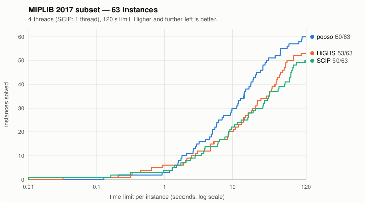
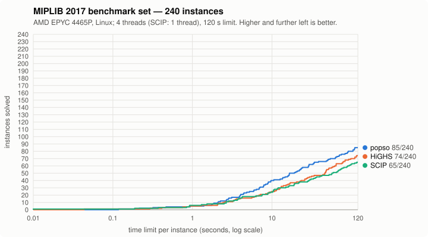
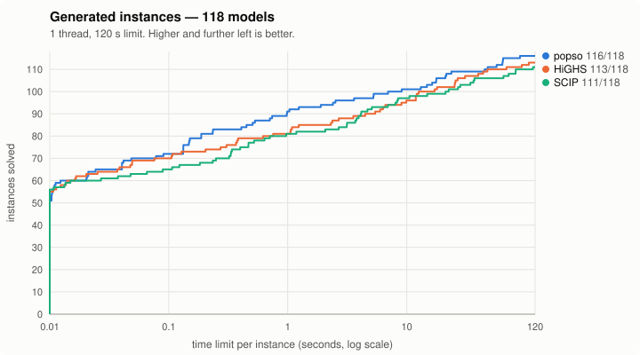
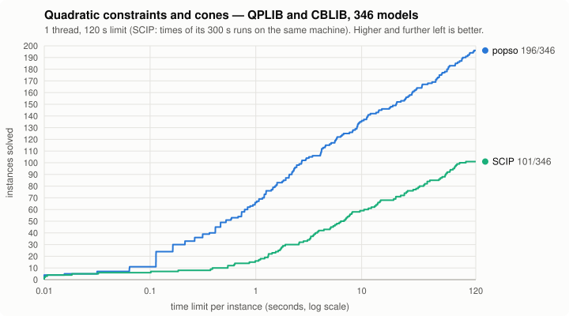

# Benchmarks

How the solver compares with the open-source solvers [HiGHS](https://highs.dev) and
[SCIP](https://www.scipopt.org). Every answer is checked independently: the returned
solution must be feasible, and its objective must match the known optimum.

_Last updated 2026-11-07 for popso v0.8.0. The hard-instance and 240-instance MIPLIB runs are
v0.7.0's: v0.8.0 changes nothing in the MILP search beyond fixes, and its 63-instance numbers below
are new._

## Setup

- Machine: Apple M4 Pro (12 cores, 24 GB), macOS (the 240-instance run and the quadratic models:
  see their sections).
- Versions: HiGHS 1.15.1 (highspy) and SCIP 10.0 (PySCIPOpt), with default settings.
- Time limit: 120 s per instance. Memory cap: 2–2.8 GB per solver process.
- Scoring:
  - **Solved** means the solver proved optimality, infeasibility or unboundedness within the
    time limit, and the answer passed the independent check.
  - **Shifted geometric mean** of the run times uses a shift of 1 s; an unsolved instance
    counts as 120 s. Lower is better.
- Gap tolerance: popso runs at a relative gap of 1e-6; the reference solvers run at 1e-9.
- Caveats:
  - The popso MIPLIB numbers come from a single seed.
  - The v0.8.0 numbers were measured with the release candidate. The release adds only a gcc-15
    build fix, and conic QP points clipped to their bounds (a change of ~1e-16).
  - The reference times were measured separately, partly while other jobs were running.
  - Read small differences as noise.

## MIPLIB 2017 subset

63 instances from [MIPLIB 2017](https://miplib.zib.de), listed in
[`benchmarks/sets/miplib_wide_core.txt`](benchmarks/sets/miplib_wide_core.txt). popso and
HiGHS use 4 threads; SCIP's branch-and-bound is single-threaded.

**How the 63 instances were chosen.** They are a filtered subset of the official MIPLIB 2017
*benchmark* set: instances classified "easy" (known optimum) with at most about 200k nonzeros,
keeping those that at least one of HiGHS, SCIP or popso solves within 120 s, so that every
instance gives a meaningful time. This makes it a practical development set rather than an
unbiased sample, and popso has been tuned on it. The [full 240-instance benchmark
set](#full-miplib-2017-benchmark-set-240-instances) is below.



| solver | solved | shifted geomean (s) |
|---|---|---|
| popso | 62/63 | 8.8 |
| HiGHS | 53/63 | 18.9 |
| SCIP | 50/63 | 21.3 |

popso is fastest on 44 of the 63 instances. The table is seed 0. Over seeds 0, 1 and 2 popso
solves 62 / 60 / 62 instances with a shifted geometric mean of 8.8 / 8.4 / 8.1 s (v0.7.0: 61 / 60
/ 63 and 9.4 / 8.7 / 7.9 s); over all 189 runs 184 solved and 8.5 s against 184 and 8.7 s. Single runs
of the instances close to the time limit vary a lot between seeds.

<details><summary>Per instance (seconds; TL = time limit; bold = fastest)</summary>

| instance | popso | HiGHS | SCIP |
|---|---|---|---|
| 30n20b8 | **62.6** | TL | 116.6 |
| CMS750_4 | TL | TL | **77.0** |
| air05 | **13.5** | 16.8 | 21.8 |
| app1-1 | 20.0 | 14.7 | **3.8** |
| beasleyC3 | 11.8 | 12.3 | **9.1** |
| binkar10_1 | **2.2** | 23.0 | 16.6 |
| cbs-cta | **3.6** | 31.7 | 13.5 |
| cod105 | **0.9** | 62.9 | 32.7 |
| dano3_3 | **20.2** | 38.4 | 58.8 |
| dano3_5 | **59.5** | TL | TL |
| decomp2 | **0.2** | 2.1 | 1.0 |
| drayage-100-23 | 2.5 | **0.3** | 3.9 |
| drayage-25-23 | 18.3 | **0.9** | 8.7 |
| eil33-2 | **41.8** | 54.2 | 47.8 |
| enlight_hard | 1.1 | 6.4 | **0.0** |
| exp-1-500-5-5 | **0.3** | 2.5 | 1.3 |
| fiball | **2.0** | 57.1 | TL |
| h80x6320d | 34.3 | **8.5** | 71.9 |
| irp | **2.6** | 13.8 | 10.8 |
| mas76 | **17.3** | 59.2 | 34.9 |
| mc11 | 21.5 | 22.9 | **9.6** |
| mik-250-20-75-4 | **3.3** | 8.6 | 17.1 |
| mzzv11 | **12.4** | 44.4 | TL |
| mzzv42z | **3.8** | 26.1 | 69.3 |
| n2seq36q | **23.5** | 50.7 | 78.2 |
| n5-3 | 16.6 | **11.0** | 29.4 |
| neos-1122047 | **1.3** | 2.9 | 1.8 |
| neos-1171448 | **5.5** | 79.4 | 6.0 |
| neos-1445765 | **17.5** | 43.3 | 20.0 |
| neos-1582420 | **5.8** | 14.5 | 16.9 |
| neos-2978193-inde | **15.9** | 21.5 | TL |
| neos-3004026-krka | **0.5** | TL | 35.1 |
| neos-3083819-nubu | **2.6** | 5.3 | 3.9 |
| neos-3381206-awhea | 2.8 | **0.4** | 1.4 |
| neos-3627168-kasai | **20.1** | 48.7 | 74.4 |
| neos-4738912-atrato | **40.4** | TL | TL |
| neos-827175 | 4.2 | **2.0** | 2.8 |
| neos-911970 | **2.8** | 4.8 | 6.1 |
| neos-950242 | **1.3** | 19.0 | TL |
| neos-960392 | 7.4 | **4.8** | TL |
| neos17 | **1.1** | 4.7 | 3.5 |
| neos5 | **23.4** | 45.4 | TL |
| neos859080 | **0.2** | 0.7 | 0.3 |
| ns1208400 | **8.0** | 37.7 | TL |
| ns1830653 | **49.3** | TL | 72.0 |
| nu25-pr12 | 7.6 | **1.9** | 2.1 |
| p200x1188c | 4.6 | **0.3** | 2.4 |
| pg | 4.2 | **3.0** | 11.9 |
| pg5_34 | **87.2** | TL | TL |
| piperout-08 | **1.9** | 10.4 | 7.7 |
| piperout-27 | **5.8** | 15.5 | 6.4 |
| pk1 | **5.8** | TL | 57.8 |
| qap10 | 36.2 | **35.5** | 68.3 |
| rmatr100-p10 | **11.6** | 41.8 | 87.8 |
| rocI-4-11 | 117.4 | TL | **46.3** |
| rococoC10-001000 | **50.3** | TL | TL |
| roll3000 | 23.1 | **19.5** | 28.6 |
| seymour1 | **14.4** | 79.0 | 33.7 |
| sp150x300d | 0.1 | **0.0** | 0.2 |
| swath1 | **7.3** | 8.8 | 8.6 |
| swath3 | **21.8** | 60.4 | TL |
| timtab1 | **7.3** | 35.1 | 27.9 |
| unitcal_7 | **51.5** | 102.6 | TL |

</details>

## Hard MIPLIB instances (10-minute limit)

The 63 instances above were selected from a wider 106-instance set (MIPLIB 2017 benchmark set,
"easy", at most about 200k nonzeros). The remaining 43 are the ones that none of popso, HiGHS or
SCIP solved within 120 s. They are listed in
[`benchmarks/sets/miplib_hard.txt`](benchmarks/sets/miplib_hard.txt) and were run with a
600 s limit (popso v0.7.0), otherwise with the same settings as above. All have known optimal values, so every
answer is checked.


| solver | solved | shifted geomean (s) |
|---|---|---|
| popso | 16/43 | 298.5 |
| HiGHS | 12/43 | 487.5 |
| SCIP | 6/43 | 564.7 |

Most of these instances stay unsolved by all three solvers at 10 minutes. HiGHS hit its memory limit on
supportcase18; popso stays within 2 GB on all 43. Earlier versions solved 9 (v0.3.0, shifted geometric
mean 468.9 s), 15 (v0.5.0, 324.9 s) and 18 (v0.6.0, 281.5 s) of these instances. v0.7.0 solves
neos-1171737 and neos-1456979 again (163 s and 170 s), but not app1-2, csched007, icir97_tension and
supportcase26, which v0.6.0 solved in 308-472 s in its run. Those four depend on the seed: with seed 1,
v0.6.3 and v0.7.0 each solve one of them (csched007, 260 s and 243 s) and none of the other three.
Unlike the 63-instance set, this set was not used for tuning until v0.5.0; since then several of its
instances have been development targets. popso solves 7 that neither reference solver does
(fhnw-binpack4-48, glass4, mas74, neos-1171737, supportcase18, supportcase40, wachplan); HiGHS solves
four that popso does not (blp-ic98, csched007, csched008, sct2), SCIP one (csched008).

<details><summary>Per instance (seconds; TL = time limit; bold = fastest)</summary>

| instance | popso | HiGHS | SCIP |
|---|---|---|---|
| 50v-10 | TL | TL | TL |
| app1-2 | TL | TL | TL |
| blp-ic98 | TL | **571.3** | TL |
| bppc4-08 | TL | TL | TL |
| chromaticindex512-7 | TL | TL | TL |
| cost266-UUE | TL | TL | TL |
| csched007 | TL | **566.6** | TL |
| csched008 | TL | **152.9** | 585.9 |
| fhnw-binpack4-48 | **0.1** | TL | TL |
| gen-ip054 | 434.7 | **395.7** | TL |
| germanrr | TL | TL | TL |
| glass4 | **48.9** | TL | TL |
| gmu-35-40 | TL | TL | TL |
| gmu-35-50 | TL | TL | TL |
| graphdraw-domain | **205.5** | 490.7 | 409.7 |
| ic97_potential | TL | TL | TL |
| icir97_tension | TL | TL | TL |
| leo1 | TL | TL | TL |
| lotsize | TL | TL | TL |
| mas74 | **105.0** | TL | TL |
| mcsched | **80.5** | 248.3 | 149.9 |
| milo-v12-6-r2-40-1 | TL | TL | TL |
| neos-1171737 | **163.5** | TL | TL |
| neos-1456979 | **169.6** | 325.2 | 425.5 |
| neos-3216931-puriri | **94.5** | 191.3 | TL |
| neos-4338804-snowy | TL | TL | TL |
| neos-4387871-tavua | TL | TL | TL |
| neos-4954672-berkel | TL | TL | TL |
| neos-5107597-kakapo | TL | TL | TL |
| neos-933966 | **40.6** | TL | 577.9 |
| nexp-150-20-8-5 | **13.1** | 127.4 | TL |
| ran14x18-disj-8 | **67.4** | 344.1 | TL |
| reblock115 | TL | TL | TL |
| rmatr200-p5 | TL | TL | TL |
| rococoB10-011000 | TL | TL | TL |
| sct2 | TL | **270.6** | TL |
| supportcase18 | **569.8** | TL | TL |
| supportcase26 | TL | TL | TL |
| supportcase40 | **147.3** | TL | TL |
| tr12-30 | 220.2 | **162.7** | 386.4 |
| trento1 | TL | TL | TL |
| uct-subprob | TL | TL | TL |
| wachplan | **334.2** | TL | TL |

</details>

## Full MIPLIB 2017 benchmark set (240 instances)

All 240 instances of the official MIPLIB 2017 benchmark set, without selection
([`benchmarks/sets/miplib_benchmark.txt`](benchmarks/sets/miplib_benchmark.txt)). The reference
values are MIPLIB's own (232 optimal, 7 infeasible, 1 best known), so every answer is checked.
This run (popso v0.7.0) used a second machine:

- Machine: AMD EPYC 4465P (12 cores, 24 hardware threads, 62 GB), Linux; six solver runs at a time.
- Versions and scoring as above; 120 s per instance, 4 threads (SCIP's branch-and-bound is
  single-threaded), memory cap 8 GB per solver process.
- The HiGHS and SCIP results were measured on the same machine with the same settings, in
  [`benchmarks/reference/miplib_benchmark_epyc.json`](benchmarks/reference/miplib_benchmark_epyc.json).
  v0.6.0's run used an Intel i7-7700K (75 solved, HiGHS 63, SCIP 53 there), so the two are not directly
  comparable.
- popso ran the v0.7.0 release code. neos-5104907-jarama went past the memory cap (counted unsolved).



| solver | solved | shifted geomean (s) |
|---|---|---|
| popso | 89/240 | 56.0 |
| HiGHS | 74/240 | 66.3 |
| SCIP | 65/240 | 69.1 |

No solver solves 144 of the 240 instances within 2 minutes. popso is fastest on 53 instances
(HiGHS 25, SCIP 18) and solves 11 that neither reference solver does (30n20b8, comp07-2idx, dano3_5,
fhnw-binpack4-48, mcsched, mushroom-best, neos-4738912-atrato, neos-933966, netdiversion,
nexp-150-20-8-5, ran14x18-disj-8). HiGHS or SCIP solve 7 that popso does not: csched008, fast0507,
neos-4722843-widden, rail507, rocI-4-11, supportcase33 and unitcal_7.

<details><summary>Per instance (seconds; TL = time limit; bold = fastest)</summary>

| instance | popso | HiGHS | SCIP |
|---|---|---|---|
| 30n20b8 | **93.5** | TL | TL |
| 50v-10 | TL | TL | TL |
| CMS750_4 | **40.3** | TL | 93.5 |
| academictimetablesmall | TL | TL | TL |
| air05 | 20.3 | **17.0** | 19.3 |
| app1-1 | 40.2 | 10.8 | **4.2** |
| app1-2 | TL | TL | TL |
| assign1-5-8 | TL | TL | TL |
| atlanta-ip | TL | TL | TL |
| b1c1s1 | TL | TL | TL |
| bab2 | TL | TL | TL |
| bab6 | TL | TL | TL |
| beasleyC3 | 24.5 | 13.1 | **10.4** |
| binkar10_1 | **3.7** | 15.9 | 18.9 |
| blp-ar98 | TL | TL | TL |
| blp-ic98 | TL | TL | TL |
| bnatt400 | TL | TL | TL |
| bnatt500 | TL | TL | TL |
| bppc4-08 | TL | TL | TL |
| brazil3 | TL | TL | TL |
| buildingenergy | TL | TL | TL |
| cbs-cta | **3.8** | 29.6 | 14.9 |
| chromaticindex1024-7 | TL | TL | TL |
| chromaticindex512-7 | TL | TL | TL |
| cmflsp50-24-8-8 | TL | TL | TL |
| co-100 | TL | TL | TL |
| cod105 | **1.5** | 58.3 | 33.3 |
| comp07-2idx | **9.7** | TL | TL |
| comp21-2idx | TL | TL | TL |
| cost266-UUE | TL | TL | TL |
| cryptanalysiskb128n5obj14 | TL | TL | TL |
| cryptanalysiskb128n5obj16 | TL | TL | TL |
| csched007 | TL | TL | TL |
| csched008 | TL | **97.8** | TL |
| cvs16r128-89 | TL | TL | TL |
| dano3_3 | **31.4** | 45.4 | 56.0 |
| dano3_5 | **68.6** | TL | TL |
| decomp2 | **0.5** | 11.4 | 0.9 |
| drayage-100-23 | 4.4 | **0.3** | 3.9 |
| drayage-25-23 | 11.3 | **0.9** | 8.9 |
| dws008-01 | TL | TL | TL |
| eil33-2 | 94.7 | **48.6** | 52.1 |
| eilA101-2 | TL | TL | TL |
| enlight_hard | 1.6 | 7.1 | **0.0** |
| ex10 | **9.0** | 22.4 | TL |
| ex9 | 3.0 | **2.6** | 19.0 |
| exp-1-500-5-5 | **0.5** | 2.1 | 1.5 |
| fast0507 | TL | TL | **116.0** |
| fastxgemm-n2r6s0t2 | TL | TL | TL |
| fhnw-binpack4-4 | **7.1** | TL | 10.2 |
| fhnw-binpack4-48 | **0.2** | TL | TL |
| fiball | **3.7** | 51.4 | TL |
| gen-ip002 | TL | TL | TL |
| gen-ip054 | TL | TL | TL |
| germanrr | TL | TL | TL |
| gfd-schedulen180f7d50m30k18 | TL | TL | TL |
| glass-sc | TL | TL | TL |
| glass4 | TL | TL | TL |
| gmu-35-40 | TL | TL | TL |
| gmu-35-50 | TL | TL | TL |
| graph20-20-1rand | 98.3 | TL | **3.3** |
| graphdraw-domain | TL | TL | TL |
| h80x6320d | 41.2 | **9.2** | 67.4 |
| highschool1-aigio | TL | TL | TL |
| hypothyroid-k1 | 11.6 | 6.4 | **3.7** |
| ic97_potential | TL | TL | TL |
| icir97_tension | TL | TL | TL |
| irish-electricity | TL | TL | TL |
| irp | **5.6** | 12.7 | 10.7 |
| istanbul-no-cutoff | 93.0 | TL | **56.7** |
| k1mushroom | TL | TL | TL |
| lectsched-5-obj | TL | TL | TL |
| leo1 | TL | TL | TL |
| leo2 | TL | TL | TL |
| lotsize | TL | TL | TL |
| mad | TL | TL | TL |
| map10 | TL | TL | TL |
| map16715-04 | TL | TL | TL |
| markshare2 | TL | TL | TL |
| markshare_4_0 | **17.4** | 77.6 | 71.2 |
| mas74 | TL | TL | TL |
| mas76 | **17.1** | 56.0 | 40.1 |
| mc11 | 38.5 | 28.0 | **10.4** |
| mcsched | **115.3** | TL | TL |
| mik-250-20-75-4 | **5.4** | 8.3 | 22.2 |
| milo-v12-6-r2-40-1 | TL | TL | TL |
| momentum1 | TL | TL | TL |
| mushroom-best | **118.8** | TL | TL |
| mzzv11 | **22.3** | 63.9 | TL |
| mzzv42z | **7.6** | 25.8 | 73.7 |
| n2seq36q | **32.3** | 47.6 | 76.1 |
| n3div36 | TL | TL | TL |
| n5-3 | **19.9** | 20.3 | 28.8 |
| neos-1122047 | 2.9 | **2.4** | 2.7 |
| neos-1171448 | 10.3 | 110.0 | **6.3** |
| neos-1171737 | TL | TL | TL |
| neos-1354092 | TL | TL | TL |
| neos-1445765 | 26.8 | 47.5 | **21.5** |
| neos-1456979 | TL | TL | TL |
| neos-1582420 | **11.6** | 23.2 | 16.5 |
| neos-2075418-temuka | TL | TL | TL |
| neos-2657525-crna | TL | TL | TL |
| neos-2746589-doon | TL | TL | TL |
| neos-2978193-inde | **9.7** | 11.4 | TL |
| neos-2987310-joes | 7.3 | **3.3** | 11.7 |
| neos-3004026-krka | **0.9** | TL | 42.3 |
| neos-3024952-loue | TL | TL | TL |
| neos-3046615-murg | TL | TL | TL |
| neos-3083819-nubu | **1.6** | 6.0 | 4.2 |
| neos-3216931-puriri | TL | TL | TL |
| neos-3381206-awhea | 3.9 | 3.6 | **1.3** |
| neos-3402294-bobin | **35.4** | 109.8 | TL |
| neos-3402454-bohle | TL | TL | TL |
| neos-3555904-turama | TL | TL | TL |
| neos-3627168-kasai | **21.2** | 46.4 | 89.2 |
| neos-3656078-kumeu | TL | TL | TL |
| neos-3754480-nidda | TL | TL | TL |
| neos-3988577-wolgan | TL | TL | TL |
| neos-4300652-rahue | TL | TL | TL |
| neos-4338804-snowy | TL | TL | TL |
| neos-4387871-tavua | TL | TL | TL |
| neos-4413714-turia | 89.4 | **13.0** | TL |
| neos-4532248-waihi | TL | TL | TL |
| neos-4647030-tutaki | TL | TL | TL |
| neos-4722843-widden | TL | **82.9** | TL |
| neos-4738912-atrato | **72.4** | TL | TL |
| neos-4763324-toguru | TL | TL | TL |
| neos-4954672-berkel | TL | TL | TL |
| neos-5049753-cuanza | TL | TL | TL |
| neos-5052403-cygnet | TL | TL | TL |
| neos-5093327-huahum | TL | TL | TL |
| neos-5104907-jarama | TL | TL | TL |
| neos-5107597-kakapo | TL | TL | TL |
| neos-5114902-kasavu | TL | TL | TL |
| neos-5188808-nattai | TL | TL | TL |
| neos-5195221-niemur | TL | TL | TL |
| neos-631710 | TL | TL | TL |
| neos-662469 | TL | TL | TL |
| neos-787933 | 3.0 | TL | **0.9** |
| neos-827175 | 8.1 | **2.1** | 2.8 |
| neos-848589 | TL | TL | TL |
| neos-860300 | 64.4 | **9.0** | 16.0 |
| neos-873061 | TL | TL | TL |
| neos-911970 | **5.2** | 15.0 | 7.6 |
| neos-933966 | **59.7** | TL | TL |
| neos-950242 | **3.1** | 12.5 | TL |
| neos-957323 | **28.0** | 43.4 | 97.6 |
| neos-960392 | 10.3 | **6.8** | TL |
| neos17 | **1.8** | 4.0 | 3.7 |
| neos5 | **53.7** | 61.2 | TL |
| neos8 | 13.1 | 2.1 | **0.8** |
| neos859080 | **0.3** | 0.8 | 0.4 |
| net12 | TL | TL | TL |
| netdiversion | **88.0** | TL | TL |
| nexp-150-20-8-5 | **18.1** | TL | TL |
| ns1116954 | 11.7 | **1.3** | TL |
| ns1208400 | **12.4** | 48.3 | TL |
| ns1644855 | TL | TL | TL |
| ns1760995 | TL | TL | TL |
| ns1830653 | **73.4** | TL | 79.9 |
| ns1952667 | TL | TL | TL |
| nu25-pr12 | 13.2 | 3.5 | **2.5** |
| nursesched-medium-hint03 | TL | TL | TL |
| nursesched-sprint02 | 15.2 | **13.9** | 36.2 |
| nw04 | **16.1** | 31.5 | 27.9 |
| opm2-z10-s4 | TL | TL | TL |
| p200x1188c | 7.3 | **0.4** | 2.7 |
| peg-solitaire-a3 | TL | TL | TL |
| pg | 7.0 | **3.2** | 12.0 |
| pg5_34 | TL | TL | TL |
| physiciansched3-3 | TL | TL | TL |
| physiciansched6-2 | 10.1 | **5.6** | 100.5 |
| piperout-08 | **4.3** | 16.7 | 8.9 |
| piperout-27 | 15.7 | 27.1 | **7.5** |
| pk1 | **12.2** | TL | 68.3 |
| proteindesign121hz512p9 | TL | TL | TL |
| proteindesign122trx11p8 | TL | TL | TL |
| qap10 | **49.1** | 64.0 | 65.3 |
| radiationm18-12-05 | TL | TL | TL |
| radiationm40-10-02 | TL | TL | TL |
| rail01 | TL | TL | TL |
| rail02 | TL | TL | TL |
| rail507 | TL | TL | **109.3** |
| ran14x18-disj-8 | **106.4** | TL | TL |
| rd-rplusc-21 | TL | TL | TL |
| reblock115 | TL | TL | TL |
| rmatr100-p10 | **17.4** | 46.3 | 87.1 |
| rmatr200-p5 | TL | TL | TL |
| rocI-4-11 | TL | TL | **58.8** |
| rocII-5-11 | TL | TL | TL |
| rococoB10-011000 | TL | TL | TL |
| rococoC10-001000 | **84.1** | 115.4 | TL |
| roi2alpha3n4 | TL | TL | TL |
| roi5alpha10n8 | TL | TL | TL |
| roll3000 | 51.3 | **25.8** | 30.8 |
| s100 | TL | TL | TL |
| s250r10 | TL | TL | TL |
| satellites2-40 | TL | TL | TL |
| satellites2-60-fs | TL | TL | TL |
| savsched1 | TL | TL | TL |
| sct2 | TL | TL | TL |
| seymour | TL | TL | TL |
| seymour1 | **21.8** | 75.7 | 29.6 |
| sing326 | TL | TL | TL |
| sing44 | TL | TL | TL |
| snp-02-004-104 | TL | TL | TL |
| sorrell3 | TL | TL | TL |
| sp150x300d | 0.2 | **0.0** | 0.2 |
| sp97ar | TL | TL | TL |
| sp98ar | TL | TL | TL |
| splice1k1 | TL | TL | TL |
| square41 | TL | TL | TL |
| square47 | TL | TL | TL |
| supportcase10 | TL | TL | TL |
| supportcase12 | TL | TL | TL |
| supportcase18 | TL | TL | TL |
| supportcase19 | TL | TL | TL |
| supportcase22 | TL | TL | TL |
| supportcase26 | TL | TL | TL |
| supportcase33 | TL | **91.8** | TL |
| supportcase40 | TL | TL | TL |
| supportcase42 | TL | TL | TL |
| supportcase6 | TL | TL | TL |
| supportcase7 | 65.0 | **52.1** | TL |
| swath1 | 10.8 | 9.9 | **9.5** |
| swath3 | **49.3** | 78.7 | TL |
| tbfp-network | **75.2** | 114.8 | TL |
| thor50dday | TL | TL | TL |
| timtab1 | **13.9** | 33.9 | 35.0 |
| tr12-30 | TL | TL | TL |
| traininstance2 | TL | TL | TL |
| traininstance6 | TL | TL | TL |
| trento1 | TL | TL | TL |
| triptim1 | 82.8 | **64.2** | TL |
| uccase12 | TL | TL | TL |
| uccase9 | TL | TL | TL |
| uct-subprob | TL | TL | TL |
| unitcal_7 | TL | **82.8** | TL |
| var-smallemery-m6j6 | TL | TL | TL |
| wachplan | TL | TL | TL |

</details>

## Generated instances

163 models from random families of increasing size
([`benchmarks/instances/`](benchmarks/instances), produced by
[`benchmarks/generators/`](benchmarks/generators)):
- scheduling and lot-sizing (job shop, lot sizing, time-indexed);
- routing and networks (TSP, CVRP, fixed-charge network design, transport);
- combinatorial models (knapsack, multi-dimensional knapsack, set cover and packing, bin
  packing, generalized assignment, subset sum, pigeonhole);
- facility location (CFLP);
- random LPs and MILPs;
- models with logical constraints: minimum lot sizes with semi-continuous variables
  (`semilot`), networks with piecewise-linear costs, plant closing and single sourcing via
  SOS1/SOS2, indicator and semi-continuous constraints (`pwlnet`), and single-machine
  scheduling with indicator disjunctions (`indsched`);
- convex quadratic programs: portfolio optimization (`portfolio`), constrained least squares
  (`lsq`), and the MIQPs cardinality-constrained portfolio (`miqpport`), random
  convex MIQPs (`miqprand`) and production targets in squares of integers (`sqtrack`);
- convex quadratic constraints (since v0.8): portfolios with a risk constraint and cardinality
  limits (`portqc`) and random convex MIQCQPs (`qcrand`);
- hand-written LP/MIP edge cases (infeasible, unbounded, degenerate, empty rows, free
  variables, objective sense).

All solvers use 1 thread. HiGHS cannot read the 8 models with SOS or indicator constraints and has
no MIQP solver and no quadratic constraints; its counts are over the other 130 models. Three MIQPs have no proven reference
optimum; popso's optimal answers there are consistent with the known bounds and count as solved.



| solver | solved | shifted geomean (s) |
|---|---|---|
| popso | 161/163 | 0.8 |
| HiGHS | 125/130 | 1.3 |
| SCIP | 145/163 | 2.1 |

popso leaves gap_hard_1 and qcrand_hard_1 unsolved (SCIP neither; HiGHS times out on gap_hard_1 and
does not read qcrand_hard_1). The
`sqtrack` models take 0.02-0.14 s each (the squares as a MILP with tangent rows), the quadratic-constraint
families `portqc` and `qcrand` 0.0-1.0 s up to the large ones (SCIP: time limits on portqc_large,
portqc_hard and qcrand_large).

<details><summary>Per instance (seconds; TL = time limit; bold = fastest)</summary>

| instance | popso | HiGHS | SCIP |
|---|---|---|---|
| binpack_hard_1 | 10.6 | 26.8 | **3.1** |
| binpack_large_1 | **0.0** | 0.1 | 0.3 |
| binpack_medium_1 | 0.0 | **0.0** | 0.0 |
| binpack_small_1 | 0.0 | 0.0 | **0.0** |
| binpack_tiny_1 | 0.0 | 0.0 | **0.0** |
| cflp_hard_1 | 54.9 | **47.7** | TL |
| cflp_large_1 | 33.9 | **25.7** | TL |
| cflp_medium_1 | 6.9 | **6.0** | 8.3 |
| cflp_small_1 | **0.2** | 0.8 | 0.6 |
| cflp_tiny_1 | 0.0 | 0.0 | **0.0** |
| cvrp_large_1 | **4.9** | 9.0 | 10.5 |
| cvrp_medium_1 | 1.6 | **1.2** | 2.1 |
| cvrp_small_1 | 0.1 | 0.1 | **0.1** |
| cvrp_tiny_1 | 0.0 | 0.0 | **0.0** |
| gap_hard_1 | TL | TL | TL |
| gap_large_1 | **8.1** | 12.6 | 82.4 |
| gap_medium_1 | **1.5** | 12.1 | 5.1 |
| gap_small_1 | **0.1** | 0.6 | 0.4 |
| gap_tiny_1 | 0.0 | 0.0 | **0.0** |
| indsched_large_1 | 0.3 | - | **0.0** |
| indsched_medium_1 | 0.0 | - | **0.0** |
| indsched_small_1 | **0.0** | - | 0.0 |
| indsched_tiny_1 | 0.0 | - | **0.0** |
| jobshop_hard_1 | **5.3** | 17.2 | 37.1 |
| jobshop_large_1 | **14.6** | 25.4 | 28.2 |
| jobshop_medium_1 | 1.9 | **0.3** | 8.0 |
| jobshop_small_1 | 0.1 | **0.0** | 0.5 |
| jobshop_tiny_1 | 0.0 | 0.0 | **0.0** |
| knapsack_large_1 | **0.0** | 0.1 | 0.3 |
| knapsack_medium_1 | 0.0 | 0.0 | **0.0** |
| knapsack_small_1 | 0.0 | 0.0 | **0.0** |
| knapsack_tiny_1 | 0.0 | 0.0 | **0.0** |
| lotsize_hard_1 | **45.3** | 92.7 | 82.1 |
| lotsize_large_1 | **10.7** | 11.9 | 14.9 |
| lotsize_medium_1 | **5.7** | 6.6 | 6.9 |
| lotsize_small_1 | **0.2** | 0.3 | 0.5 |
| lotsize_tiny_1 | 0.0 | 0.0 | **0.0** |
| lpsanity_beale_cycling_0 | 0.0 | **0.0** | 0.0 |
| lpsanity_degenerate_0 | 0.0 | **0.0** | 0.0 |
| lpsanity_dual_degenerate_0 | 0.0 | 0.0 | **0.0** |
| lpsanity_empty_col_0 | 0.0 | 0.0 | **0.0** |
| lpsanity_empty_row_0 | 0.0 | **0.0** | 0.0 |
| lpsanity_empty_row_infeasible_0 | 0.0 | **0.0** | 0.0 |
| lpsanity_extra_free_row_0 | 0.0 | 0.0 | **0.0** |
| lpsanity_feasible_0 | 0.0 | **0.0** | 0.0 |
| lpsanity_fixed_0 | 0.0 | **0.0** | 0.0 |
| lpsanity_fixed_format_0 | 0.0 | 0.0 | **0.0** |
| lpsanity_freevars_0 | 0.0 | 0.0 | **0.0** |
| lpsanity_illscaled_0 | 0.0 | **0.0** | 0.0 |
| lpsanity_inconsistent_eq_0 | 0.0 | **0.0** | 0.0 |
| lpsanity_infeasible_0 | 0.0 | **0.0** | 0.0 |
| lpsanity_infeasible_bounds_0 | 0.0 | **0.0** | 0.0 |
| lpsanity_klee_minty_0 | 0.0 | **0.0** | 0.0 |
| lpsanity_mip_equality_0 | 0.0 | 0.0 | **0.0** |
| lpsanity_mip_knapsack_0 | 0.0 | 0.0 | **0.0** |
| lpsanity_mip_marker_0 | 0.0 | 0.0 | **0.0** |
| lpsanity_mip_marker_defaults_0 | 0.0 | 0.0 | **0.0** |
| lpsanity_mip_mixed_bounds_0 | 0.0 | 0.0 | **0.0** |
| lpsanity_mip_negative_ub_0 | **0.0** | TL | TL |
| lpsanity_mip_parity_infeasible_0 | 0.0 | 0.0 | **0.0** |
| lpsanity_mip_unbounded_0 | **0.0** | 0.0 | 0.1 |
| lpsanity_negative_lb_0 | 0.0 | **0.0** | 0.0 |
| lpsanity_negative_ub_0 | **0.0** | TL | TL |
| lpsanity_objoffset_0 | 0.0 | 0.0 | **0.0** |
| lpsanity_objsense_inline_0 | 0.0 | **0.0** | 0.0 |
| lpsanity_objsense_maximize_0 | 0.0 | 0.0 | **0.0** |
| lpsanity_ranges_0 | 0.0 | **0.0** | 0.0 |
| lpsanity_redundant_eq_0 | 0.0 | 0.0 | **0.0** |
| lpsanity_unbounded_0 | 0.0 | 0.0 | **0.0** |
| lpsanity_unbounded_free_0 | 0.0 | 0.0 | **0.0** |
| lpsanity_upper_only_0 | 0.0 | 0.0 | **0.0** |
| lsq_large_1 | **1.3** | 2.0 | TL |
| lsq_medium_1 | **0.1** | 0.1 | TL |
| lsq_small_1 | 0.0 | **0.0** | 0.3 |
| lsq_tiny_1 | 0.0 | **0.0** | 0.0 |
| miqpport_hard_1 | **0.9** | - | TL |
| miqpport_large_1 | **0.2** | - | 13.4 |
| miqpport_medium_1 | **0.0** | - | 1.2 |
| miqpport_small_1 | **0.0** | - | 0.6 |
| miqpport_tiny_1 | **0.0** | - | 0.1 |
| miqprand_hard_1 | **2.5** | - | TL |
| miqprand_large_1 | **0.3** | - | TL |
| miqprand_medium_1 | **0.0** | - | 35.6 |
| miqprand_small_1 | **0.0** | - | TL |
| miqprand_tiny_1 | **0.0** | - | 0.1 |
| mkp_hard_1 | **5.7** | 43.9 | 22.6 |
| mkp_large_1 | **1.0** | 4.5 | 3.1 |
| mkp_medium_1 | **0.7** | 2.3 | 4.7 |
| mkp_small_1 | **0.1** | 0.1 | 0.1 |
| mkp_tiny_1 | 0.0 | 0.0 | **0.0** |
| netdesign_hard_1 | **18.9** | 30.9 | 36.4 |
| netdesign_large_1 | **0.6** | 5.4 | 4.1 |
| netdesign_medium_1 | **0.3** | 0.4 | 1.2 |
| netdesign_small_1 | 0.0 | 0.0 | **0.0** |
| netdesign_tiny_1 | 0.0 | 0.0 | **0.0** |
| pigeon_large_1 | 0.0 | **0.0** | 0.2 |
| pigeon_medium_1 | 0.0 | **0.0** | 0.1 |
| pigeon_small_1 | 0.0 | **0.0** | 0.0 |
| pigeon_tiny_1 | 0.0 | 0.0 | **0.0** |
| portfolio_large_1 | 0.0 | **0.0** | 1.2 |
| portfolio_medium_1 | 0.1 | **0.0** | 7.9 |
| portfolio_small_1 | 0.0 | **0.0** | 0.0 |
| portfolio_tiny_1 | 0.0 | **0.0** | 0.0 |
| portqc_hard_1 | **1.0** | - | TL |
| portqc_large_1 | **0.1** | - | TL |
| portqc_medium_1 | **0.0** | - | 1.0 |
| portqc_small_1 | **0.0** | - | 0.4 |
| portqc_tiny_1 | **0.0** | - | 0.0 |
| pwlnet_large_1 | **1.2** | - | 5.1 |
| pwlnet_medium_1 | **0.1** | - | 0.2 |
| pwlnet_small_1 | 0.0 | - | **0.0** |
| pwlnet_tiny_1 | 0.0 | - | **0.0** |
| qcrand_hard_1 | TL | - | TL |
| qcrand_large_1 | **0.2** | - | TL |
| qcrand_medium_1 | **0.0** | - | 0.4 |
| qcrand_small_1 | **0.0** | - | 0.2 |
| qcrand_tiny_1 | 0.0 | - | **0.0** |
| randlp_large_1 | **19.3** | 39.9 | 65.1 |
| randlp_medium_1 | 0.1 | **0.0** | 0.5 |
| randlp_small_1 | 0.0 | **0.0** | 0.0 |
| randmilp_hard_1 | **62.5** | TL | 71.9 |
| randmilp_large_1 | **9.9** | 25.3 | 21.2 |
| randmilp_medium_1 | **0.1** | 0.2 | 0.2 |
| randmilp_small_1 | 0.0 | 0.0 | **0.0** |
| randmilp_tiny_1 | 0.0 | 0.0 | **0.0** |
| semilot_large_1 | 5.1 | **1.3** | TL |
| semilot_medium_1 | 0.1 | 0.1 | **0.0** |
| semilot_small_1 | 0.1 | 0.0 | **0.0** |
| semilot_tiny_1 | 0.0 | 0.0 | **0.0** |
| setcover_hard_1 | **0.5** | 2.7 | 3.8 |
| setcover_large_1 | **0.8** | 2.4 | 4.2 |
| setcover_medium_1 | **0.2** | 1.1 | 0.7 |
| setcover_small_1 | 0.0 | 0.0 | **0.0** |
| setcover_tiny_1 | 0.0 | 0.0 | **0.0** |
| setpack_hard_1 | **57.8** | TL | TL |
| setpack_large_1 | **2.9** | 9.9 | 8.5 |
| setpack_medium_1 | **0.2** | 1.1 | 1.0 |
| setpack_small_1 | 0.0 | 0.0 | **0.0** |
| setpack_tiny_1 | 0.0 | 0.0 | **0.0** |
| sqtrack_hard_1 | **0.1** | - | 1.8 |
| sqtrack_large_1 | **0.0** | - | 0.3 |
| sqtrack_medium_1 | **0.0** | - | 0.0 |
| sqtrack_small_1 | **0.0** | - | 1.7 |
| sqtrack_tiny_1 | **0.0** | - | 0.0 |
| subsetsum_medium_1 | **1.2** | 3.6 | 3.9 |
| subsetsum_small_1 | **0.0** | 0.0 | 0.0 |
| timeidx_hard_1 | 19.1 | **18.0** | 34.3 |
| timeidx_large_1 | **7.4** | 11.9 | 27.0 |
| timeidx_medium_1 | 0.6 | 1.1 | **0.3** |
| timeidx_small_1 | 0.1 | 0.0 | **0.0** |
| timeidx_tiny_1 | 0.0 | 0.0 | **0.0** |
| transinf_medium_1 | 0.0 | 0.0 | **0.0** |
| transinf_small_1 | 0.0 | 0.0 | **0.0** |
| transport_large_1 | **0.1** | 0.4 | 2.7 |
| transport_medium_1 | 0.0 | **0.0** | 0.0 |
| transport_small_1 | 0.0 | **0.0** | 0.0 |
| tsp_hard_1 | **61.0** | 106.1 | TL |
| tsp_large_1 | 105.7 | **68.9** | 115.1 |
| tsp_medium_1 | 4.6 | 6.3 | **3.7** |
| tsp_small_1 | **0.3** | 0.4 | 0.3 |
| tsp_tiny_1 | 0.0 | 0.0 | **0.0** |
| unbdmilp_medium_1 | 0.0 | **0.0** | 0.2 |
| unbdmilp_small_1 | 0.0 | **0.0** | 0.0 |

</details>

## Quadratic constraints and cones (QPLIB, CBLIB)

v0.8 adds quadratic constraints and second-order cones. These are measured on public libraries:

- [QPLIB](https://qplib.zib.de) (CC BY 4.0), converted from its LP files with
  [`benchmarks/tools/qplib.py`](benchmarks/tools/qplib.py). Each conversion is checked with QPLIB's
  published solution point, which must be feasible with the published objective. The sets are:
  - the 27 convex QCQP / MIQCQP instances (13 continuous, 14 mixed-integer);
  - 17 convex QPs;
  - 17 convex MIQPs;
  - the 128 nonconvex instances whose variables are all binary (classes QBL, QBN, LBQ, QBQ).
    popso linearizes their products exactly.
- [CBLIB](https://cblib.zib.de): 157 mixed-integer second-order cone programs, converted from CBF
  with [`benchmarks/tools/cblib.py`](benchmarks/tools/cblib.py).

Setup:
- Machine: AMD EPYC 4465P (12 cores, Linux), twelve 1-thread runs at a time.
- popso v0.9.0: 1 thread, 120 s, gap 1e-6.
- SCIP 10.0: 1 thread, 300 s, feasibility tolerance 1e-9; a SCIP time counts as solved if it is at
  most 120 s.
- HiGHS has no quadratic constraints; it appears only on the QPs (300 s).
- Every returned point is verified. Quadratic rows are checked to 1e-6, scaled by their terms'
  magnitude; a cone is checked by the distance in its norm form, so a point near a cone's tip
  cannot use the squared form's looser tolerance. Reference points that fail this check (SCIP's on
  some cones) are dropped.
- Six references carry a wider comparison tolerance, with a note: models where the 1e-6
  feasibility tolerance itself moves the optimum, such as cones of radius 7e-4.



| set | instances | popso solved (geomean s) | SCIP | HiGHS |
|---|---|---|---|---|
| QPLIB convex QCQP / MIQCQP | 27 | 21 (11.0) | 6 (90.2) | - |
| QPLIB convex QP | 17 | 15 (3.6) | 0 (120.0) | 7/17 (45.1) |
| QPLIB convex MIQP | 17 | 4 (45.3) | 0 (120.0) | - |
| QPLIB nonconvex over binaries | 128 | 39 (47.5) | 8 (113.5) | - |
| CBLIB MISOCP | 157 | 117 (12.1) | 87 (23.5) | - |
| **all** | 346 | **196** (20.3) | 101 (55.2) | |

Shifted geometric means of the run times: shift 1 s, an unsolved instance counts as 120 s.

Notes:
- **Continuous QCQPs:** the conic interior-point method solves QPLIB's 13 continuous convex QCQPs
  in 0.1 to 15 s each; SCIP solves 1 of them within 300 s (verified).
- **Quadratic knapsack rows (QPLIB class LMC):** one dense quadratic row over binaries. Linearized
  exactly, it is solved as a MILP; popso solves 8 of 12 within 120 s, SCIP 5 (6 within 300 s).
- **Nonconvex models over binaries:** with 300 s and 4 threads, popso proves 47 of the 128
  optimal and SCIP 13 (1 thread). Where both finish, their objectives are equal, and equal to
  QPLIB's. Where neither finishes, popso's solution is better on 68 of 70.
- **CBLIB:** by family, popso solves more instances than SCIP in 12 of the 26 families and fewer
  in 3: the layout families `no7` and `o7`, and `shortfall`. v0.9 solves 117 (v0.8: 108): its
  presolve for quadratic models turns the `uflquad-nopsc` constraints into their perspective
  cones, and integral points are completed by the conic method with the integers fixed.
- **QPs:** popso tries the conic method first and falls back to the QP barrier. SCIP finishes none
  of the 17 within 300 s; HiGHS finishes 7, with the same objectives where both finish (to 1e-5).

<details><summary>Per instance (seconds; TL = time limit; - = no reference run)</summary>

| instance | set | popso | SCIP | HiGHS |
|---|---|---|---|---|
| QPLIB_10001 | QCQP | **5.7** | 13.7 | - |
| QPLIB_10002 | QCQP | **21.5** | 41.7 | - |
| QPLIB_10003 | QCQP | 81.0 | TL | - |
| QPLIB_10004 | QCQP | TL | TL | - |
| QPLIB_10005 | QCQP | TL | TL | - |
| QPLIB_10006 | QCQP | TL | TL | - |
| QPLIB_10007 | QCQP | TL | TL | - |
| QPLIB_10008 | QCQP | **52.3** | 96.9 | - |
| QPLIB_10009 | QCQP | 28.4 | **25.4** | - |
| QPLIB_10010 | QCQP | 32.7 | **14.9** | - |
| QPLIB_10011 | QCQP | 66.3 | TL | - |
| QPLIB_10012 | QCQP | 51.2 | TL | - |
| QPLIB_2456 | QCQP | 0.6 | TL | - |
| QPLIB_2468 | QCQP | 2.7 | TL | - |
| QPLIB_2482 | QCQP | 0.1 | TL | - |
| QPLIB_2519 | QCQP | 0.3 | TL | - |
| QPLIB_2626 | QCQP | 0.9 | TL | - |
| QPLIB_2676 | QCQP | **0.1** | 57.8 | - |
| QPLIB_2784 | QCQP | 0.2 | TL | - |
| QPLIB_2862 | QCQP | 4.2 | TL | - |
| QPLIB_3029 | QCQP | 0.2 | TL | - |
| QPLIB_3088 | QCQP | 0.2 | TL | - |
| QPLIB_3105 | QCQP | 4.1 | TL | - |
| QPLIB_3185 | QCQP | 1.5 | TL | - |
| QPLIB_3312 | QCQP | 9.4 | TL | - |
| QPLIB_3678 | QCQP | TL | TL | - |
| QPLIB_7579 | QCQP | TL | TL | - |
| QPLIB_10034 | QP | 21.4 | - | TL |
| QPLIB_10038 | QP | 37.2 | - | TL |
| QPLIB_8495 | QP | 1.0 | - | TL |
| QPLIB_8500 | QP | TL | - | TL |
| QPLIB_8515 | QP | 0.1 | - | TL |
| QPLIB_8559 | QP | **9.2** | - | 30.5 |
| QPLIB_8567 | QP | **11.2** | - | 28.0 |
| QPLIB_8602 | QP | TL | - | TL |
| QPLIB_8616 | QP | **0.1** | - | 26.0 |
| QPLIB_8785 | QP | 4.1 | - | TL |
| QPLIB_8790 | QP | 0.4 | - | TL |
| QPLIB_8792 | QP | **0.3** | - | 3.1 |
| QPLIB_8845 | QP | 0.2 | - | TL |
| QPLIB_8906 | QP | 0.4 | - | **0.2** |
| QPLIB_8938 | QP | **0.1** | - | 76.0 |
| QPLIB_8991 | QP | **0.1** | - | 2.0 |
| QPLIB_9002 | QP | 1.2 | - | TL |
| QPLIB_10050 | MIQP | 0.3 | TL | - |
| QPLIB_10056 | MIQP | 0.2 | TL | - |
| QPLIB_10069 | MIQP | 0.2 | TL | - |
| QPLIB_3547 | MIQP | TL | TL | - |
| QPLIB_3694 | MIQP | TL | TL | - |
| QPLIB_3698 | MIQP | TL | TL | - |
| QPLIB_3708 | MIQP | 8.7 | TL | - |
| QPLIB_3792 | MIQP | TL | TL | - |
| QPLIB_3861 | MIQP | TL | TL | - |
| QPLIB_3871 | MIQP | TL | TL | - |
| QPLIB_3913 | MIQP | TL | TL | - |
| QPLIB_3980 | MIQP | TL | TL | - |
| QPLIB_4270 | MIQP | TL | TL | - |
| QPLIB_5527 | MIQP | TL | TL | - |
| QPLIB_5543 | MIQP | TL | TL | - |
| QPLIB_5577 | MIQP | TL | TL | - |
| QPLIB_5924 | MIQP | TL | TL | - |
| QPLIB_0067 | binary | **9.2** | 14.3 | - |
| QPLIB_0633 | binary | TL | TL | - |
| QPLIB_0752 | binary | TL | TL | - |
| QPLIB_10040 | binary | 0.2 | TL | - |
| QPLIB_10041 | binary | 2.1 | TL | - |
| QPLIB_10042 | binary | 0.1 | TL | - |
| QPLIB_10043 | binary | 0.5 | TL | - |
| QPLIB_10044 | binary | 1.0 | TL | - |
| QPLIB_10045 | binary | 2.3 | TL | - |
| QPLIB_10046 | binary | 0.2 | TL | - |
| QPLIB_10047 | binary | 2.2 | TL | - |
| QPLIB_10048 | binary | 37.5 | TL | - |
| QPLIB_10049 | binary | 2.2 | TL | - |
| QPLIB_10051 | binary | 2.2 | TL | - |
| QPLIB_10052 | binary | 0.7 | TL | - |
| QPLIB_10053 | binary | 0.7 | TL | - |
| QPLIB_10054 | binary | 19.7 | TL | - |
| QPLIB_10055 | binary | 0.5 | TL | - |
| QPLIB_10057 | binary | 0.3 | TL | - |
| QPLIB_10058 | binary | 64.2 | TL | - |
| QPLIB_10059 | binary | TL | TL | - |
| QPLIB_10060 | binary | 0.6 | TL | - |
| QPLIB_10061 | binary | TL | TL | - |
| QPLIB_10062 | binary | 2.6 | TL | - |
| QPLIB_10063 | binary | TL | TL | - |
| QPLIB_10064 | binary | 2.7 | TL | - |
| QPLIB_10065 | binary | 1.3 | TL | - |
| QPLIB_10066 | binary | 0.4 | TL | - |
| QPLIB_10067 | binary | 0.5 | TL | - |
| QPLIB_10068 | binary | TL | TL | - |
| QPLIB_10070 | binary | TL | TL | - |
| QPLIB_10071 | binary | 0.4 | TL | - |
| QPLIB_10072 | binary | 0.5 | TL | - |
| QPLIB_10073 | binary | 0.8 | TL | - |
| QPLIB_10074 | binary | 9.0 | TL | - |
| QPLIB_1976 | binary | TL | TL | - |
| QPLIB_2017 | binary | TL | TL | - |
| QPLIB_2022 | binary | TL | TL | - |
| QPLIB_2029 | binary | TL | TL | - |
| QPLIB_2036 | binary | TL | TL | - |
| QPLIB_2047 | binary | TL | TL | - |
| QPLIB_2055 | binary | TL | TL | - |
| QPLIB_2060 | binary | TL | TL | - |
| QPLIB_2067 | binary | TL | TL | - |
| QPLIB_2073 | binary | TL | TL | - |
| QPLIB_2077 | binary | TL | TL | - |
| QPLIB_2085 | binary | TL | TL | - |
| QPLIB_2087 | binary | 100.8 | TL | - |
| QPLIB_2096 | binary | TL | TL | - |
| QPLIB_2315 | binary | TL | TL | - |
| QPLIB_2357 | binary | TL | TL | - |
| QPLIB_2359 | binary | TL | TL | - |
| QPLIB_2492 | binary | TL | TL | - |
| QPLIB_2512 | binary | TL | TL | - |
| QPLIB_2733 | binary | TL | TL | - |
| QPLIB_2880 | binary | TL | TL | - |
| QPLIB_2957 | binary | TL | TL | - |
| QPLIB_3307 | binary | TL | TL | - |
| QPLIB_3347 | binary | TL | TL | - |
| QPLIB_3361 | binary | TL | TL | - |
| QPLIB_3380 | binary | 67.8 | TL | - |
| QPLIB_3402 | binary | TL | TL | - |
| QPLIB_3413 | binary | TL | TL | - |
| QPLIB_3506 | binary | TL | TL | - |
| QPLIB_3565 | binary | TL | 63.1 | - |
| QPLIB_3584 | binary | TL | TL | - |
| QPLIB_3587 | binary | TL | TL | - |
| QPLIB_3614 | binary | TL | TL | - |
| QPLIB_3642 | binary | TL | TL | - |
| QPLIB_3650 | binary | TL | TL | - |
| QPLIB_3693 | binary | TL | TL | - |
| QPLIB_3703 | binary | TL | TL | - |
| QPLIB_3705 | binary | TL | TL | - |
| QPLIB_3706 | binary | TL | TL | - |
| QPLIB_3709 | binary | TL | TL | - |
| QPLIB_3714 | binary | **30.0** | 79.8 | - |
| QPLIB_3738 | binary | TL | TL | - |
| QPLIB_3745 | binary | TL | TL | - |
| QPLIB_3750 | binary | TL | TL | - |
| QPLIB_3751 | binary | TL | TL | - |
| QPLIB_3752 | binary | TL | TL | - |
| QPLIB_3757 | binary | TL | TL | - |
| QPLIB_3762 | binary | **50.3** | 76.4 | - |
| QPLIB_3772 | binary | TL | TL | - |
| QPLIB_3775 | binary | TL | TL | - |
| QPLIB_3803 | binary | TL | TL | - |
| QPLIB_3815 | binary | 88.5 | **55.6** | - |
| QPLIB_3822 | binary | TL | TL | - |
| QPLIB_3832 | binary | TL | TL | - |
| QPLIB_3834 | binary | TL | TL | - |
| QPLIB_3838 | binary | TL | TL | - |
| QPLIB_3841 | binary | TL | TL | - |
| QPLIB_3850 | binary | TL | TL | - |
| QPLIB_3852 | binary | **61.2** | 75.4 | - |
| QPLIB_3860 | binary | TL | TL | - |
| QPLIB_3865 | binary | TL | TL | - |
| QPLIB_3877 | binary | TL | TL | - |
| QPLIB_3883 | binary | TL | TL | - |
| QPLIB_3923 | binary | TL | TL | - |
| QPLIB_3931 | binary | TL | TL | - |
| QPLIB_5721 | binary | TL | TL | - |
| QPLIB_5725 | binary | TL | TL | - |
| QPLIB_5755 | binary | 3.4 | TL | - |
| QPLIB_5875 | binary | TL | TL | - |
| QPLIB_5881 | binary | TL | TL | - |
| QPLIB_5882 | binary | TL | TL | - |
| QPLIB_5909 | binary | TL | TL | - |
| QPLIB_5922 | binary | TL | TL | - |
| QPLIB_5935 | binary | TL | TL | - |
| QPLIB_5944 | binary | **54.2** | 68.2 | - |
| QPLIB_5962 | binary | TL | TL | - |
| QPLIB_5971 | binary | TL | TL | - |
| QPLIB_5980 | binary | 96.6 | TL | - |
| QPLIB_6324 | binary | TL | TL | - |
| QPLIB_6487 | binary | TL | TL | - |
| QPLIB_6597 | binary | TL | TL | - |
| QPLIB_6647 | binary | TL | TL | - |
| QPLIB_6757 | binary | TL | TL | - |
| QPLIB_6764 | binary | TL | TL | - |
| QPLIB_6799 | binary | TL | TL | - |
| QPLIB_6941 | binary | TL | TL | - |
| QPLIB_7127 | binary | **0.4** | 20.1 | - |
| QPLIB_7139 | binary | 54.3 | TL | - |
| QPLIB_7144 | binary | TL | TL | - |
| QPLIB_7149 | binary | TL | TL | - |
| QPLIB_7154 | binary | TL | TL | - |
| QPLIB_7159 | binary | TL | TL | - |
| QPLIB_7164 | binary | TL | TL | - |
| achtziger_stolpe06-6.1flowc | CBLIB | 0.3 | TL | - |
| achtziger_stolpe06-6.2flowc | CBLIB | TL | TL | - |
| achtziger_stolpe06-6.5bflowc | CBLIB | TL | TL | - |
| achtziger_stolpe06-6.5flowc | CBLIB | 64.1 | TL | - |
| achtziger_stolpe07-5.1flowc | CBLIB | TL | TL | - |
| achtziger_stolpe07-5.2bflowc | CBLIB | TL | TL | - |
| achtziger_stolpe07-5.2flowc | CBLIB | TL | TL | - |
| achtziger_stolpe07-5.3flowc | CBLIB | 4.1 | TL | - |
| b1bigflowc | CBLIB | TL | TL | - |
| classical_200_0 | CBLIB | TL | TL | - |
| classical_200_1 | CBLIB | TL | TL | - |
| classical_50_0 | CBLIB | TL | TL | - |
| classical_50_1 | CBLIB | 33.3 | TL | - |
| classical_50_2 | CBLIB | 31.6 | TL | - |
| classical_50_3 | CBLIB | TL | TL | - |
| classical_50_4 | CBLIB | 77.1 | TL | - |
| clay0203h | CBLIB | 2.1 | **1.3** | - |
| clay0203m | CBLIB | 1.2 | **0.6** | - |
| clay0204h | CBLIB | 10.0 | **7.6** | - |
| clay0204m | CBLIB | 4.5 | **1.5** | - |
| clay0205h | CBLIB | 42.3 | **30.7** | - |
| clay0205m | CBLIB | 66.0 | **9.7** | - |
| clay0303h | CBLIB | 3.0 | TL | - |
| clay0303m | CBLIB | 1.9 | **1.1** | - |
| clay0304h | CBLIB | 8.2 | TL | - |
| clay0304m | CBLIB | 12.1 | **3.8** | - |
| clay0305h | CBLIB | 104.1 | **34.2** | - |
| clay0305m | CBLIB | 105.5 | **14.1** | - |
| du-opt | CBLIB | **3.0** | 3.1 | - |
| du-opt5 | CBLIB | 6.5 | **1.4** | - |
| estein4_A | CBLIB | 0.1 | TL | - |
| estein4_B | CBLIB | **0.1** | 0.9 | - |
| estein4_C | CBLIB | 0.1 | TL | - |
| estein4_nr22 | CBLIB | 0.1 | TL | - |
| estein5_A | CBLIB | 1.6 | TL | - |
| estein5_B | CBLIB | 1.2 | TL | - |
| estein5_C | CBLIB | 1.2 | TL | - |
| estein5_nr1 | CBLIB | 1.6 | TL | - |
| estein5_nr21 | CBLIB | 1.5 | TL | - |
| ex1223a | CBLIB | **0.0** | 0.0 | - |
| fac3 | CBLIB | 0.1 | TL | - |
| flay02h | CBLIB | 0.2 | TL | - |
| flay02m | CBLIB | 0.1 | TL | - |
| flay03h | CBLIB | 2.3 | TL | - |
| flay03m | CBLIB | 0.7 | TL | - |
| flay04h | CBLIB | 14.4 | TL | - |
| flay04m | CBLIB | 18.3 | TL | - |
| flay05h | CBLIB | TL | TL | - |
| flay05m | CBLIB | TL | TL | - |
| flay06h | CBLIB | TL | TL | - |
| flay06m | CBLIB | TL | TL | - |
| gbd | CBLIB | **0.0** | 0.0 | - |
| m3 | CBLIB | **0.1** | 0.2 | - |
| m6 | CBLIB | **1.6** | 1.8 | - |
| m7 | CBLIB | 4.6 | **3.2** | - |
| m7_ar25_1 | CBLIB | 5.9 | **2.8** | - |
| m7_ar2_1 | CBLIB | 9.6 | **6.8** | - |
| m7_ar3_1 | CBLIB | 9.1 | **5.6** | - |
| m7_ar4_1 | CBLIB | 2.7 | **2.6** | - |
| m7_ar5_1 | CBLIB | 18.8 | **10.5** | - |
| netmod_dol2 | CBLIB | **23.5** | 25.3 | - |
| netmod_kar1 | CBLIB | **1.9** | 8.2 | - |
| netmod_kar2 | CBLIB | **2.1** | 7.8 | - |
| no7_ar25_1 | CBLIB | TL | 44.2 | - |
| no7_ar2_1 | CBLIB | 76.6 | **21.1** | - |
| no7_ar3_1 | CBLIB | TL | 73.1 | - |
| no7_ar4_1 | CBLIB | TL | TL | - |
| no7_ar5_1 | CBLIB | 88.6 | **62.0** | - |
| nvs03 | CBLIB | **0.0** | 0.0 | - |
| o7 | CBLIB | TL | TL | - |
| o7_2 | CBLIB | TL | TL | - |
| o7_ar25_1 | CBLIB | TL | TL | - |
| o7_ar2_1 | CBLIB | TL | 84.3 | - |
| o7_ar3_1 | CBLIB | TL | TL | - |
| o7_ar4_1 | CBLIB | TL | TL | - |
| o7_ar5_1 | CBLIB | TL | TL | - |
| o8_ar4_1 | CBLIB | TL | TL | - |
| o9_ar4_1 | CBLIB | TL | TL | - |
| pp-n10-d10 | CBLIB | **0.0** | 0.1 | - |
| pp-n10-d10000 | CBLIB | **0.0** | 3.3 | - |
| pp-n100-d10 | CBLIB | **2.4** | 5.4 | - |
| pp-n100-d10000 | CBLIB | TL | TL | - |
| pp-n1000-d10 | CBLIB | TL | TL | - |
| pp-n1000-d10000 | CBLIB | TL | TL | - |
| robust_100_0 | CBLIB | TL | TL | - |
| robust_100_1 | CBLIB | TL | TL | - |
| robust_50_0 | CBLIB | **1.1** | 1.3 | - |
| robust_50_1 | CBLIB | 1.8 | TL | - |
| robust_50_2 | CBLIB | 1.8 | TL | - |
| robust_50_3 | CBLIB | 3.2 | TL | - |
| robust_50_4 | CBLIB | 15.5 | TL | - |
| shortfall_100_0 | CBLIB | TL | TL | - |
| shortfall_100_1 | CBLIB | TL | TL | - |
| shortfall_50_0 | CBLIB | TL | 35.2 | - |
| shortfall_50_1 | CBLIB | 37.1 | **3.9** | - |
| shortfall_50_2 | CBLIB | 57.0 | **6.1** | - |
| shortfall_50_3 | CBLIB | 115.5 | **26.5** | - |
| shortfall_50_4 | CBLIB | 90.3 | **11.6** | - |
| slay04h | CBLIB | **0.5** | 1.7 | - |
| slay04m | CBLIB | **0.3** | 0.5 | - |
| slay05h | CBLIB | 1.3 | **1.1** | - |
| slay05m | CBLIB | **0.5** | 0.6 | - |
| slay06h | CBLIB | **1.4** | 4.4 | - |
| slay06m | CBLIB | **0.8** | 1.3 | - |
| slay07h | CBLIB | 5.2 | **3.6** | - |
| slay07m | CBLIB | 1.1 | **1.0** | - |
| slay08h | CBLIB | 11.1 | **6.3** | - |
| slay08m | CBLIB | **1.2** | 1.6 | - |
| slay09h | CBLIB | **11.5** | 15.1 | - |
| slay09m | CBLIB | 4.3 | **1.2** | - |
| slay10h | CBLIB | 57.9 | TL | - |
| slay10m | CBLIB | 21.1 | **12.4** | - |
| sssd-strong-15-4 | CBLIB | 7.7 | **3.3** | - |
| sssd-strong-15-8 | CBLIB | **10.5** | 23.4 | - |
| sssd-strong-20-4 | CBLIB | **0.9** | 1.7 | - |
| sssd-strong-20-8 | CBLIB | **25.4** | 78.0 | - |
| sssd-strong-25-4 | CBLIB | 30.5 | **5.1** | - |
| sssd-strong-25-8 | CBLIB | 84.3 | TL | - |
| sssd-strong-30-4 | CBLIB | 5.6 | **5.0** | - |
| sssd-strong-30-8 | CBLIB | TL | 69.0 | - |
| sssd-weak-15-4 | CBLIB | 5.8 | **3.7** | - |
| sssd-weak-15-8 | CBLIB | 14.6 | **13.3** | - |
| sssd-weak-20-4 | CBLIB | **0.4** | 3.5 | - |
| sssd-weak-20-8 | CBLIB | **29.9** | 38.7 | - |
| sssd-weak-25-4 | CBLIB | **1.4** | 1.8 | - |
| sssd-weak-25-8 | CBLIB | 46.3 | TL | - |
| sssd-weak-30-4 | CBLIB | 8.3 | **8.1** | - |
| sssd-weak-30-8 | CBLIB | 50.1 | TL | - |
| tls12 | CBLIB | TL | TL | - |
| tls2 | CBLIB | **0.1** | 0.4 | - |
| tls4 | CBLIB | 11.4 | **7.1** | - |
| tls5 | CBLIB | TL | TL | - |
| tls6 | CBLIB | TL | TL | - |
| tls7 | CBLIB | TL | TL | - |
| turbine07 | CBLIB | 0.1 | **0.0** | - |
| turbine07GF | CBLIB | **0.0** | 0.0 | - |
| turbine07_aniso | CBLIB | 0.1 | TL | - |
| turbine07_lowb | CBLIB | **0.7** | 1.9 | - |
| turbine07_lowb_aniso | CBLIB | 0.7 | **0.5** | - |
| turbine54 | CBLIB | 1.0 | **0.4** | - |
| turbine54GF | CBLIB | **0.0** | 0.0 | - |
| uflquad-nopsc-10-100 | CBLIB | **0.8** | 7.4 | - |
| uflquad-nopsc-10-150 | CBLIB | **2.4** | 7.2 | - |
| uflquad-nopsc-20-100 | CBLIB | **5.0** | 41.7 | - |
| uflquad-nopsc-20-150 | CBLIB | **6.4** | 64.5 | - |
| uflquad-nopsc-30-100 | CBLIB | **13.7** | 61.4 | - |
| uflquad-nopsc-30-150 | CBLIB | **4.2** | 54.0 | - |
| uflquad-nopsc-30-200 | CBLIB | 26.3 | TL | - |
| uflquad-nopsc-30-300 | CBLIB | TL | TL | - |
| uflquad-psc-10-100 | CBLIB | **0.8** | 2.6 | - |
| uflquad-psc-10-150 | CBLIB | **4.2** | 5.8 | - |
| uflquad-psc-20-100 | CBLIB | **6.8** | 21.0 | - |
| uflquad-psc-20-150 | CBLIB | **5.6** | 39.5 | - |
| uflquad-psc-30-100 | CBLIB | **26.0** | 32.7 | - |
| uflquad-psc-30-150 | CBLIB | **2.3** | 27.1 | - |
| uflquad-psc-30-200 | CBLIB | 27.6 | TL | - |
| uflquad-psc-30-300 | CBLIB | 113.3 | TL | - |

</details>

### Nonconvex models with continuous or general integer variables (since v0.10)

QPLIB's 261 nonconvex instances that are not purely binary
([`benchmarks/sets/qplib_nonconvex.txt`](benchmarks/sets/qplib_nonconvex.txt), converted with
`benchmarks/tools/qplib.py --nonconvex`). v0.10 solves them by spatial branch-and-bound with plain
McCormick relaxations. This is a first version, and SCIP is ahead on this set.

Setup: same machine, twelve 1-thread runs at a time; popso v0.10.2 and SCIP 10.0 with 1 thread,
120 s, gap 1e-6, each with its default feasibility tolerance. An instance counts as solved when the
solver proves optimality and the objective agrees with the one QPLIB publishes (to 1e-4 relative).

| | popso | SCIP |
|---|---|---|
| proven optimal within 120 s (of 261) | 23 | **30** |
| returns a solution within 120 s | 135 | - |
| objectives that differ from QPLIB's | 0 | 0 |
| solved by both | 18 | 18 |
| solved only by this solver | 5 | 12 |
| shifted geomean (s) | 92.6 | 92.7 |

By QPLIB class (popso / SCIP / instances): LMQ 13 / 19 / 133, LCQ 4 / 4 / 52, QML 5 / 3 / 11,
LGQ 0 / 2 / 3, QIL 1 / 1 / 2, QMQ 0 / 1 / 1; neither solver proves any of the other 59 (QCQ 30,
DCQ 7, QCL 6, CMQ 6, CCQ 4, and 6 more).

Notes:
- popso returns a solution on 135 of the 261 (v0.10.0: 110; v0.10.2 looks for a first solution before the
  search by fixing one factor of every product and solving what is left); every returned point is verified on
  the model as given. No run ended with an error or over the memory limit. Of SCIP's runs, 15 ended with an
  error and 4 at the memory limit; they count as unsolved.
- Where popso stops at the time limit, it is mostly the dual bound that is missing: plain McCormick
  rows are weak on dense products, and there are no RLT or other strengthened relaxations yet.
- On QPLIB_5927 popso's point (objective 39.14) is better than the value listed by QPLIB (169.57);
  SCIP's solution checker accepts the point on the converted model.

<details><summary>Per instance, where either solver finishes (seconds; TL = time limit)</summary>

| instance | class | popso | SCIP |
|---|---|---|---|
| QPLIB_0031 | QML | TL | **25.8** |
| QPLIB_0684 | LMQ | TL | **108.6** |
| QPLIB_2167 | LMQ | TL | **27.7** |
| QPLIB_2635 | LCQ | **0.0** | 30.9 |
| QPLIB_2698 | LCQ | TL | **63.2** |
| QPLIB_2702 | QML | 62.3 | **40.2** |
| QPLIB_2714 | LCQ | 1.0 | **0.3** |
| QPLIB_2881 | LCQ | **0.1** | TL |
| QPLIB_2882 | LMQ | **94.8** | TL |
| QPLIB_3060 | QML | 101.4 | **68.9** |
| QPLIB_3122 | QML | **8.9** | TL |
| QPLIB_3247 | LCQ | 0.7 | **0.4** |
| QPLIB_3279 | LMQ | TL | **2.3** |
| QPLIB_3496 | LGQ | TL | **3.6** |
| QPLIB_3514 | LMQ | **0.7** | 2.2 |
| QPLIB_3554 | QML | **31.4** | TL |
| QPLIB_3620 | LMQ | TL | **50.9** |
| QPLIB_3622 | LMQ | **5.1** | 6.6 |
| QPLIB_3624 | LMQ | **4.6** | 11.3 |
| QPLIB_3643 | LGQ | TL | **15.6** |
| QPLIB_3645 | LMQ | 42.4 | **8.4** |
| QPLIB_3646 | LMQ | **0.7** | 2.4 |
| QPLIB_3676 | LMQ | **16.6** | 38.5 |
| QPLIB_3677 | LMQ | **2.2** | 11.2 |
| QPLIB_3690 | LMQ | **6.2** | 18.3 |
| QPLIB_3725 | LMQ | TL | **87.5** |
| QPLIB_3727 | LMQ | **0.3** | 1.2 |
| QPLIB_3790 | QML | **0.7** | TL |
| QPLIB_3813 | LMQ | **1.3** | 3.6 |
| QPLIB_3814 | QMQ | TL | **0.4** |
| QPLIB_3816 | LMQ | TL | **119.3** |
| QPLIB_4805 | LMQ | TL | **112.6** |
| QPLIB_8153 | LMQ | 0.7 | **0.3** |
| QPLIB_8381 | LMQ | 7.9 | **3.6** |
| QPLIB_9048 | QIL | 66.5 | **30.2** |

</details>

## popso over time

The same 63 MIPLIB instances and settings, for every released version (each measured once,
partly with other jobs running, so differences of a few percent are noise).


| version | solved | shifted geomean (s) |
|---|---|---|
| v0.1.0 | 59/63 | 13.2 |
| v0.2.0 | 60/63 | 12.4 |
| v0.2.1 | 60/63 | 11.3 |
| v0.3.0 | 60/63 | 11.4 |
| v0.4.0 | 59/63 | 10.5 |
| v0.5.0 | 58/63 | 10.7 |
| v0.6.0 | 59/63 | 9.0 |
| v0.7.0 | 61/63 | 9.4 |
| v0.8.0 | 62/63 | 8.8 |

v0.3.0 adds new features (barrier LP, logical constraints) rather than MILP speed, so its
MIPLIB numbers match v0.2.1. v0.4.0 (new: QP / MIQP, better c-MIR aggregation, symmetry-breaking
reductions) is a few percent faster over three seeds; it solves one instance fewer in this run
because two instances close to the 120 s limit just miss it (both finish in 113 s and 157 s
with a longer limit). v0.5.0 (root strong branching, network cut-set cuts, a local-search
heuristic and earlier root heuristics, conflict analysis, presolve of long equations and implied
integers) is about 4% faster than v0.4.0 over three seeds (shifted geometric mean of all 189 runs
10.5 s against 10.9 s, 178 against 176 solved); on this set its single seed-0 run is no faster.
Most of its gains are on the hard instances. v0.6.0 (repeated root restarts, probing liftings and
sparsify in presolve, cheaper roots, budgets for the heuristics' LPs, a column-scaled cost
perturbation in the dual simplex, compact open-node storage) is about 14% faster than v0.5.0 over
three seeds (shifted geometric mean of all 189 runs 9.0 s against 10.5 s, 179 against 178 solved)
and solves 18 of the 43 hard instances against 15. v0.7.0 (objective propagation with clique
implications, a root cut loop that backs off on wide models, faster clique and c-MIR separation, the trivial
objective bound, presolve substitution with implied bounds, a concurrent barrier on large roots) solves
two more in this seed-0 run at a slightly higher geometric mean; over three seeds it is about 4% faster
than v0.6.0 (all 189 runs: 8.7 s against 9.0 s, 184 against 179 solved). v0.8.0 (quadratic
constraints and cones; the MILP search unchanged apart from fixes) solves 62 in this run; over three
seeds it is about 2% faster than v0.7.0 (all 189 runs: 8.5 s against 8.7 s, 184 solved each). The plot
shows the last four versions.

## Commercial solvers

This page compares popso with open-source solvers only, so that anyone can reproduce every
number. Commercial MILP solvers are still clearly faster on MIPLIB; for independent
comparisons that include commercial solvers see Hans Mittelmann's
[benchmarks for optimization software](https://plato.asu.edu/bench.html).

## Reproduce

```sh
python3 -m venv .venv && .venv/bin/pip install -r benchmarks/requirements.txt
.venv/bin/python benchmarks/miplib/download.py --wide          # MIPLIB files (not in the repo)
.venv/bin/python benchmarks/run.py --solver build/popso --set miplib_wide_core -t 120 --threads 4 --mem-limit 2048
.venv/bin/python benchmarks/run.py --solver build/popso --set miplib_hard -t 600 --threads 4 --mem-limit 2048
.venv/bin/python benchmarks/miplib/download.py --benchmark     # all 240 (~640 MB)
.venv/bin/python benchmarks/run.py --solver build/popso --set miplib_benchmark -t 120 --threads 4 --mem-limit 8192 \
    --reference benchmarks/reference/miplib_benchmark_x86.json
.venv/bin/python benchmarks/run.py --solver build/popso -t 120 --threads 1 --mem-limit 2048
# tables and plots from a result file
.venv/bin/python benchmarks/tools/readme_table.py benchmarks/results/<run>.json --solvers popso,highs,scip
.venv/bin/python benchmarks/tools/plot_profile.py benchmarks/results/<run>.json --title "..." --out docs/<name>.svg
```

The reference results (HiGHS, SCIP) are produced by `benchmarks/reference.py`; see
[benchmarks/README.md](benchmarks/README.md).
