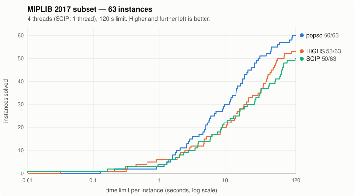

<p align="center"></p>

# popso

[](https://github.com/gozwei/popso/actions/workflows/ci.yml)

**popso** (Polkowski's Optimization Solver) is an open-source solver for **mixed-integer linear programs (MILP)** and **linear programs
(LP)**, since v0.4 for **convex quadratic programs (QP)** and **mixed-integer convex quadratic programs (MIQP)**, and, since v0.8, for
**convex quadratically constrained and second-order cone programs** (QCQP / MIQCQP, SOCP / MISOCP) and quadratic models over
binaries, convex or not. It is written from scratch in C++20 using only the standard library.

This is a fun side project by [Marcin Polkowski](https://marcinpolkowski.com). The goal is
a fully open-source solver that holds its own against the best solvers on real
problems. It is built with heavy use of AI coding agents. More problem classes are planned.



On a 63-instance [MIPLIB 2017](https://miplib.zib.de) subset it currently solves more
instances, and is faster overall, than the open-source solvers HiGHS and SCIP:

| solver | solved | shifted geomean (s) |
|---|---|---|
| popso | 62/63 | 8.8 |
| HiGHS 1.15 | 53/63 | 18.9 |
| SCIP 10 | 50/63 | 21.3 |

On the 43 harder instances of the same collection that no solver finishes in 2 minutes, with a
10-minute limit, popso solves 16, HiGHS 12 and SCIP 6. On the full 240-instance MIPLIB 2017
benchmark set (2 minutes, another machine) it solves 89, HiGHS 74 and SCIP 65. On 346 models with
quadratic constraints, second-order cones or nonconvex quadratics over binaries from
[QPLIB](https://qplib.zib.de) and [CBLIB](https://cblib.zib.de) (2 minutes, 1 thread, another
machine) it solves 196 and SCIP 101.

These numbers come from single runs and have caveats. See **[BENCHMARKS.md](BENCHMARKS.md)** for
the setup, per-instance results, the hard instances, the full benchmark set, the generated benchmark
families, the quadratic models and popso's progress across versions, and
**[CHANGELOG.md](CHANGELOG.md)** for what each version can do.

## Install

```sh
pip install popso                    # the popso command and the Python API
brew install gozwei/popso/popso      # the popso command, the C library and popso.h (macOS, Linux)
```

The pip wheels cover Linux (x86_64), macOS 11+ (Apple silicon and Intel) and Windows (x86_64); on
other platforms pip builds from source, which needs CMake and a C++20 compiler. The Homebrew formula
builds the release from source. Then:

```sh
popso model.mps --time-limit 60      # MPS, LP or CBF files, plain or gzipped
popso --help
```

## Build

To build from a source checkout, you need CMake ≥ 3.20 and a C++20 compiler (clang, gcc or MSVC). No
other dependencies.

```sh
cmake -S . -B build -DCMAKE_BUILD_TYPE=Release -DPOPSO_BUILD_TESTS=ON
cmake --build build -j 4
./build/popso_tests            # unit tests
```

On Windows with Visual Studio, add `--config Release` to the build command; the binaries are
then in `build/Release/`.

`cmake --install build --prefix <dir>` installs the `popso` executable into `<dir>/bin` (it needs
no other file at run time), the shared library with the C API into `<dir>/lib` (`bin` on Windows)
and `popso.h` into `<dir>/include`.

The solver is developed and benchmarked on macOS (Apple silicon). Continuous integration
builds it and runs the unit tests and a small end-to-end check on Linux (gcc and clang),
macOS (clang) and Windows (MSVC).

## Usage

```sh
./build/popso model.mps --sol model.sol --time-limit 60 --threads 4
```

The solver reads a model in MPS format (free or fixed) or in the CPLEX LP format and prints
a summary. Besides continuous, integer and binary variables, models may have
semi-continuous and semi-integer variables, SOS1/SOS2 constraints and indicator
constraints (MPS `SC`/`SI` bounds, `SOS` and `INDICATORS` sections; LP `Semi-Continuous` and
`SOS` sections and `b = 1 -> ...` constraints). The objective may have a convex quadratic part
(see [Quadratic objectives](#quadratic-objectives-qp-and-miqp) below). The format is chosen by the file extension (`.lp` is LP, anything else MPS,
case-insensitive); `--format lp|mps` overrides it. Gzip-compressed files (`model.mps.gz`, `model.lp.gz`, or any
file starting with the gzip magic bytes) are decompressed while reading (at most 16 GiB of decompressed data,
a guard against corrupt or malicious files; C++ `milp::set_gzip_max_output`), so MIPLIB's `.mps.gz` files can be
used directly:

```
Status: OPTIMAL
Objective: 12574
Bound: 12574
Gap: 0.0000%
Nodes: 1
Time: 0.003s
```

With `--sol` it also writes the solution as a plain `name value` file:

```
# Solution for model knapsack_small_1
# Status = OPTIMAL
# Objective value = 12574
x0 0
x1 1
...
```

| option | meaning |
|---|---|
| `--sol <file>` | write the solution file |
| `--start <file>` | starting solution in the same `name value` format; may be partial (see below) |
| `--duals <file>` | write row duals and reduced costs (`row <name> <value>` / `col <name> <value>` lines) of an LP or continuous QP; for a MILP the fixed-MIP duals (see [Dual values](#dual-values)) |
| `--format <mps\|lp>` | input format (default: from the file extension) |
| `--time-limit <sec>` | wall-clock time limit (default: none) |
| `--threads <n>` | number of threads (0 = all cores, the default) |
| `--gap <rel>` | relative optimality gap at which to stop (default 1e-4) |
| `--deterministic` | reproducible parallel search (slower; the default is opportunistic) |
| `--seed <n>` | random seed |
| `--racing <k>` | run k differently seeded searches at the same time |
| `--mem-limit <MB>` | approximate memory cap for the search tree (default 4096) |
| `--node-limit <n>` | stop after n branch-and-bound nodes |
| `--no-presolve` | disable presolve |
| `--lp-method <m>` | LP algorithm for a pure LP and the MIP root LP: `auto` (default), `simplex` or `barrier` |
| `--verbosity <0-3>` | 0 silent, 1 summary (default), 2 progress, 3 debug |
| `--profile <file>` | after the solve, write a JSON profile of the model and the run (see below) |
| `--write-anon <file>` | write an anonymized copy of the model as MPS and exit (see below; `--solve` solves as well) |
| `--version` | print the version |

**Starting solutions.** `--start` takes a solution file, for example one written by an earlier run
with `--sol`. A complete feasible start becomes the first incumbent. If only some values are given, or
the start is infeasible, the given integer values are fixed and the rest is completed by a short
sub-MIP. If that fails, the start is ignored and the log says so.

**Interrupting.** Ctrl-C (SIGINT) stops the solve within a fraction of a second; popso prints the
usual summary with the status `INTERRUPTED` and the best solution found so far (and writes `--sol` /
`--duals` files as usual). A second Ctrl-C ends the process at once.

**Models that cannot be shared.** `--write-anon anon.mps` writes a copy with generic names (`x1..`,
`c1..`), rows and columns shuffled (`--anon-seed <n>`, default 1; `--anon-keep-order` keeps the order)
and every number unchanged (up to an ulp on a ranged row MPS cannot express; popso warns): a model to
debug the solver on, without its meaning. `--anon-map map.txt` writes the private
`new_name original_name` mapping, which stays with you. `--profile profile.json` writes aggregate
statistics only: sizes, column types, row classes (MIPLIB 2017 classification), coefficient ranges,
presolve and run statistics and the incumbent trace (time, objective, the heuristic that found it), with
no names, no per-row or per-column data and no paths.

### Dual values

- **LPs** solved to optimality: row duals y and reduced costs d = c - A'y of an optimal basis. Presolve
  maps only primal solutions back (several of its reductions, such as dual fixing, dominated and
  parallel columns or substitutions, have no simple dual postsolve), so the duals are not carried
  through it: after the solve, the postsolved optimal point is turned into an optimal basis of the
  original LP (a crossover from the point, then a few simplex iterations, usually none or a handful;
  about 1 s for the 5000 x 8000 `randlp_large`, whose solve takes 24 s). Duals of an optimal basis are
  optimal, and every optimal primal-dual pair is complementary, so the duals fit the returned solution
  whether presolve ran or not. The basis comes with them (C API `popso_get_basis`, Python
  `Result.var_basis` / `Result.constr_basis`).
- **MILPs**: the "fixed-MIP" duals, those of the LP with every integer variable fixed at its value in
  the solution (with `--duals`, the C API parameter `duals` = 2 or Python `solve(duals=2)`), computed
  after the solve. They are the duals of an *optimal* basis of that fixed LP. When the solve stopped
  early (time or node limit, interrupt), the incumbent's continuous part need not be optimal for the
  fixed LP; the duals then belong to the fixed LP's optimum and need not be complementary to the
  returned solution's continuous values (the log says so: "the fixed LP's optimum ... is better than
  the incumbent's"). The returned solution itself is never changed.
- Recovered LP and fixed-MIP duals are checked against the solution: if their basis does not
  reproduce the solution's objective (relative tolerance 1e-6; for fixed-MIP duals, if it is worse)
  they are dropped ("Duals: dropped" in the log, no duals returned). An interrupt or the time limit
  (at least 1 s is allowed for the recovery) also gives up on them.
- **Continuous QPs**: from the interior point's final point (see below).
- Signs, in the model's objective sense: when minimizing, y_i >= 0 at an active row lower bound and
  <= 0 at an upper one, d_j >= 0 at a variable's lower bound and <= 0 at its upper one; the opposite
  when maximizing.
- Not for MIQPs and for models with semi-continuous variables, SOS or indicator constraints.

### Quadratic objectives (QP and MIQP)

The objective can be `c'x + 1/2 x'Qx` with a symmetric Q. In MPS, Q comes in a `QUADOBJ` section
(one triangle; an off-diagonal entry stands for both Q_ij and Q_ji) or in a `QMATRIX` / CPLEX
`QSECTION` section (the whole matrix). In the LP format, the quadratic terms go in brackets in the
objective:

```
Minimize
 obj: - x - 2 y + [ 2 x ^ 2 + 2 x * y + 4 y ^ 2 ] / 2
Subject To
 c1: x + y <= 3
End
```

- The objective must be **convex**: Q positive semidefinite when minimizing, negative
  semidefinite when maximizing. popso checks this before solving (a sparse factorization of the
  scaled Q) and reports the status `NONCONVEX` otherwise; Q that is semidefinite only up to a
  relative 1e-6 (round-off in the input) is accepted with that much added to its diagonal.
  Exception: a nonconvex objective whose quadratic terms all involve **binaries** (products of two
  binaries, a binary's square, a binary times a column with finite bounds, any term with a fixed
  column) is linearized exactly (a product of binaries becomes a new column y with
  y >= x_i + x_j - 1, y <= x_i, y <= x_j; a binary times a bounded column takes the four McCormick
  rows, exact at a binary) and solved as a MILP.
- **Presolve** for quadratic models removes fixed and empty columns (their quadratic terms move
  into the linear part), fixes columns without quadratic terms by dual arguments, turns
  singleton rows into bounds and drops empty and redundant rows; no column is substituted.
- **Continuous QPs** are solved by the conic interior-point method (homogeneous self-dual
  embedding, Q in the Newton system), with the barrier method (Q in the augmented system; the
  normal equations when Q is diagonal) for anything it does not end with an optimum (an
  infeasible or unbounded QP, numerical trouble). There is no crossover and no basis: the
  result is the primal point, the objective and the **dual values** (row duals y and reduced
  costs d = c + Qx - A'y of the final interior point, so complementarity holds to the method's
  tolerance; when minimizing, y >= 0 at an active lower row bound and <= 0 at an upper one, the
  opposite when maximizing). Infeasible and unbounded QPs are confirmed by the simplex method on
  auxiliary LPs.
- **MIQPs** (integer variables, linear constraints, convex objective) are solved by
  branch-and-bound on QP relaxations: the root by the barrier, the nodes by a dual active-set
  method warm-started from the parent node. Node bounds are Lagrangian bounds that stay valid for
  inexact solves, and they also tighten integer bounds (reduced-cost fixing). The search uses
  domain propagation, reliability branching, rounding, a QP dive and feasibility jump on a
  linearized objective; it is single-threaded and deterministic. With 2 or more threads (default
  mode), it races the outer approximation in the MILP search (the objective's epigraph row and its
  tangent planes) on the other threads: the first to finish stops the other, else the better
  incumbent with the tighter bound is reported (`MILP_MIQP_RACE=0`: the MIQP search alone).
- **Sums of squares of integer variables** (a diagonal Q whose columns are all integer, e.g.
  squared integer target errors, plus any linear terms) are solved as a MILP instead, with the full
  MILP machinery (presolve, cuts, parallel search): each square x^2 of an integer is exactly the
  maximum of its tangent lines at the integers, and popso adds those tangents around the continuous
  relaxation's point, checks every solution against the exact objective and adds more where needed.
  This relaxation is much tighter than the continuous x^2, often closing the gap at the root.
- Cutting planes are not used for MIQPs solved by this branch-and-bound yet.

The C API sets Q with `popso_set_q` / `popso_add_q_entries` (and reads it with
`popso_get_q`) and returns the duals of a continuous QP with `popso_get_duals` /
`popso_get_reduced_costs` (`popso_has_duals`); in Python, products of variables in
`set_objective` make a quadratic objective, and `Result.duals` / `Result.reduced_costs` (or
`r.dual(constr)`, `r.reduced_cost(var)`) hold the duals:

```python
x = m.add_var(lb=-10, ub=10, name="x")
y = m.add_var(lb=-10, ub=10, vtype=popso.INTEGER, name="y")
m.set_objective((x - 1) ** 2 + x * y + 2 * y * y - 3 * y)   # a popso.QuadExpr
r = m.solve()
```

### Quadratic constraints (convex QCQP and MIQCQP, since v0.8)

Rows may have quadratic terms: `a'x + x'Q_i x <= b` (or `>= b`). In MPS they come in a `QCMATRIX
<row>` section per row (the whole symmetric matrix, no 1/2) or a CPLEX `QSECTION <row>`; in the LP
format in brackets on the constraint's left side:

```
Maximize
 obj: x + y
Subject To
 disk: [ x ^ 2 + y ^ 2 ] <= 2
 c2: x - 3 y + [ x ^ 2 + 2 x * y + 3 y ^ 2 ] <= 10
General
 y
End
```

- Each quadratic row must be **convex**: one finite side, its quadratic part positive
  semidefinite towards a finite upper side (negative semidefinite towards a lower side), or a
  **second-order cone** over the columns' bounds: `x1^2 + ... + xk^2 <= t^2` with `t >= 0`
  (weights, shifts and a constant allowed: one sheet of a hyperboloid) and the rotated
  `x1^2 + ... + xk^2 <= c u v` with `u, v >= 0`. Ranged rows, equalities and other rows are
  reported as `NONCONVEX`, except rows whose quadratic terms all involve **binaries** (as for the
  objective above): convex or not, they are linearized exactly and become linear rows of the MILP
  (a quadratic knapsack row over 262 binaries, QPLIB_10010: optimal in 10 s, where tangent planes
  left a 2.3% gap after 60 s).
- Such models, continuous or mixed-integer, are solved by **outer approximation inside the MILP
  search**: the quadratic rows stay out of the LP and are represented by gradient cuts (tangent
  planes) added at the start, in the root cut loop and at every node whose LP point violates them;
  every candidate solution is checked against the exact rows, and one that violates only them gets
  its continuous part from the fixed-integer outer approximation. A convex quadratic objective
  goes along as an epigraph row. So the MILP machinery (cuts, heuristics, parallel tree) applies;
  presolve, symmetry handling and restarts are off for these models for now.
- **Continuous** models are solved by a **conic interior-point method** (homogeneous self-dual,
  Nesterov-Todd scaling, as in ECOS) on the second-order cone form: each convex quadratic row
  becomes a rotated cone through a factor of its matrix. With integer variables its optimum gives
  the first tangent planes, so the root LP starts at the continuous relaxation's bound. A
  continuous model gets **dual values** too (row duals, a quadratic row's multiplier, reduced costs
  d = c + Qx - A'y - sum_q y_q grad q(x); none at a cone's apex, where no finite multiplier exists);
  no basis.

Conic models can also be read in the **CBF** format of CBLIB (`.cbf`, `.cbf.gz`, or `--format cbf`): cones
F, L+, L-, L= and Q, QR on variables and on affine rows (a member that is not a single column gets its own
column), integers; semidefinite and exponential / power cones are rejected.

The C API adds a row's terms with `popso_add_qrow_terms` (monomial coefficients: `(i, j, c)` is
`c x_i x_j`) and reads them with `popso_get_qrow_terms`; in Python, comparing a quadratic
expression makes a quadratic constraint:

```python
m.add_constr(x * x + y ** 2 <= 2, name="disk")
m.add_constr(t >= (z - 2.6) * (z - 2.6))   # an epigraph: t >= (z - 2.6)^2
```

### C library

The build also produces a shared library (`build/libpopso.dylib`, `libpopso.so` or `popso.dll`) with
a C API declared in [`include/popso.h`](include/popso.h):

```c
#include "popso.h"

popso_model* m = popso_create();
int x, y;
popso_add_var(m, 0.0, 10.0, 3.0, POPSO_INTEGER, "x", &x);
popso_add_var(m, 0.0, POPSO_INFINITY, 4.0, POPSO_CONTINUOUS, "y", &y);
int cols[2] = {x, y};
double vals[2] = {1.0, 2.0};
popso_add_row(m, 2, cols, vals, -POPSO_INFINITY, 14.0, "c1", NULL);  /* x + 2y <= 14 */
popso_set_objective_sense(m, POPSO_MAXIMIZE);
popso_set_param(m, "time_limit", 10.0);
if (popso_solve(m) == POPSO_OK && popso_has_solution(m)) {
  double obj, sol[2];
  popso_get_objective(m, &obj);
  popso_get_solution(m, sol, 2);
}
popso_free(m);
```

Models can also be read with `popso_read_mps` or `popso_read_lp` (plain or gzipped). `popso_add_sos` and
`popso_add_indicator` add SOS1/SOS2 and indicator constraints, and the variable types
`POPSO_SEMICONTINUOUS` and `POPSO_SEMIINTEGER` make a variable 0 or within its bounds. Functions return error codes, and
`popso_last_error` describes the last failure. Separate models can be solved from different threads
at the same time. The library prints nothing unless you set the `verbosity` parameter.

Dual values (see [Dual values](#dual-values)) come from `popso_get_duals` / `popso_get_reduced_costs`
and the basis from `popso_get_basis`; `popso_has_duals` returns 1 for LP and QP duals, 2 for fixed-MIP
duals (parameter `duals`: 0 none, 1 LPs, the default, 2 also MILPs). A running solve can be stopped
from another thread or a signal handler, and new incumbents can be followed with a callback:

```c
static int on_incumbent(void* data, double objective, double bound, const double* x, int n) {
  printf("incumbent %g (bound %g)\n", objective, bound);
  return 0;  /* nonzero stops the solve */
}

popso_set_incumbent_callback(m, on_incumbent, NULL);
popso_solve(m);              /* another thread may call popso_interrupt(m) */
```

`popso_interrupt` is a single atomic store (async-signal-safe); the solve stops within a fraction of a
second with status `POPSO_STATUS_INTERRUPTED` and the best solution so far. The request is cleared when
`popso_solve` starts. Callback calls are serialized, have strictly improving objectives (in the
model's sense) and come at deterministic points with the `deterministic` parameter; the solution is in
the model's variables (presolve and reformulations undone). Returning nonzero stops the solve like
`popso_interrupt`; after that there are no further calls.

### Python

The Python package in [`python/`](python) uses `ctypes` to load the shared library. It needs no
compiled extension and no third-party packages.

```python
import popso

m = popso.Model("example")
x = m.add_var(ub=10, vtype=popso.INTEGER, name="x")
y = m.add_var(name="y")
m.add_constr(x + 2 * y <= 14)
m.add_constr(3 * x - y >= 0)
m.set_objective(3 * x + 4 * y, sense=popso.MAXIMIZE)
m.set_start({x: 4})             # optional, may be partial
r = m.solve(time_limit=10, threads=4)
print(r.status, r.objective, r.bound, r[x], r["y"], r.nodes, r.time)

m2 = popso.read_mps("model.mps.gz")             # plain or gzipped

# Dual values: LPs by default, fixed-MIP duals with duals=2
r = m.solve(duals=2)
print(r.duals, r.reduced_costs, r.fixed_mip_duals)

# Following the incumbents; returning True stops the solve (status "INTERRUPTED")
m.set_incumbent_callback(lambda objective, bound, x: print(objective, bound))
r = m.solve()

# Logical constraints
b = m.add_var(vtype=popso.BINARY, name="b")
z = m.add_var(lb=2, ub=8, vtype=popso.SEMICONTINUOUS, name="z")   # z = 0 or 2 <= z <= 8
m.add_indicator(b, 0, z <= 0)                                     # b = 0 -> z <= 0
m.add_sos([x, y, z], weights=[1, 2, 3], type=popso.SOS1)          # at most one nonzero
```

Ctrl-C during `solve()` stops the solve cleanly: `solve()` returns the result with status
`"INTERRUPTED"` and the best solution so far instead of raising `KeyboardInterrupt` (the native solve
runs on a helper thread while the main thread waits). `m.interrupt()` does the same from another
thread. An exception raised in the incumbent callback stops the solve and is re-raised by `solve()`.

Install it with pip; the package also puts the `popso` command on your PATH:

```sh
pip install popso          # wheels for Linux x86_64, macOS (Apple silicon and Intel), Windows
pip install .              # from a source checkout: builds with CMake (3.20+, a C++20 compiler)
```

From a source checkout without installing, add `python/` to `PYTHONPATH`. The library is then
found in `build/`, or you can point `POPSO_LIBRARY` at it.

## What's inside

- **QP and MIQP:** convexity test by a sparse factorization of the scaled Hessian; the conic
  interior-point method and the barrier method with the Hessian in the augmented system; branch-and-bound with a warm-started dual
  active-set QP solver at the nodes, safe Lagrangian bounds, reliability branching and QP-based
  heuristics. Sums of squares of integer variables are solved as a MILP with exact tangent rows.
- **LP:** bounded dual simplex with hyper-sparse LU factorization, Forrest–Tomlin updates and
  dual steepest-edge pricing, plus a primal simplex for cleanup. An interior-point (barrier)
  method: Mehrotra predictor-corrector with Gondzio correctors, AMD ordering and a supernodal
  sparse Cholesky factorization (normal equations or augmented system), and a crossover to an
  optimal basis. Large pure LPs, and the root LPs of large MILPs, run both methods at the same time by
  default.
- **Logical constraints:** semi-continuous and semi-integer variables, SOS1/SOS2 and
  indicator constraints, reformulated with binaries and big-M rows whose coefficients come
  from bound propagation; without finite bounds, branching on the binary enforces the
  constraint in the subtree.
- **Presolve:** singleton rows and columns, bound, coefficient and GCD tightening, parallel rows
  and columns, dual fixing and dual bound strengthening, dominated columns, aggregation and
  substitution, probing, clique merging and clique extension, with full postsolve.
- **Cutting planes:**
  - Gomory mixed-integer cuts;
  - c-MIR cuts on aggregated rows;
  - lifted knapsack covers;
  - clique, implied-bound and zero-half cuts;
  - tableau cuts at tree nodes;
  - a dynamic cut pool.
- **Primal heuristics:**
  - simple rounding, diving and local search;
  - the feasibility pump and feasibility jump;
  - large-neighbourhood sub-MIPs: RINS, RENS and crossover.
- **Branch-and-bound:**
  - reliability branching on pseudocosts with strong branching;
  - node-level domain propagation and conflict analysis;
  - reduced-cost fixing and objective propagation with clique implications;
  - symmetry handling (orbital branching, orbitopes, symmetry-breaking reductions from a
    stabilizer chain);
  - root and in-tree restarts.
- **Parallelism:** multithreaded tree search, either opportunistic or fully deterministic
  (`--deterministic` gives the same result on every run with the same thread count).
- **Robustness:** every result is checked against reference solvers. The search tree's
  memory use is bounded. A numerical failure in a node LP is recovered from instead of
  dropping that part of the tree.

## Current limitations

- **Problem classes:** LP, MILP, convex QP / MIQP, and (since v0.8) convex QCQP / MIQCQP and
  SOCP / MISOCP (quadratic rows, or the conic benchmark format CBF with linear, quadratic and
  rotated cones). No semidefinite or exponential cones, no general nonlinear constraints, no
  nonconvex objectives or constraints except those over binaries (linearized exactly).
- **Quadratic models:** a basic presolve only, no cutting planes in the MIQP branch-and-bound, which
  is single-threaded (with 2 or more threads it races the outer approximation in the parallel MILP
  search); its node QP solver keeps a dense copy of the Hessian, so MIQPs with more than 3000
  columns fall back to the much slower barrier at every node. Dual values for continuous QPs come
  from the interior point (no basis); none for MIQPs. The incumbent callback is not called for
  quadratic objectives. MIQP performance is far from the commercial solvers.
- **Quadratic constraints:** presolve, symmetry handling and restarts are off for these models;
  in deterministic mode the tangent cuts found at nodes are applied only between the rounds of the
  parallel search, so such models can be much slower there. Rows are judged to the absolute 1e-6
  tolerance (a cone by the distance in its norm form), which matters for rows on a scale far
  below 1. Dual values only for continuous models.
- **Model features:** semi-continuous variables, SOS constraints and indicator constraints
  are reformulated with binary variables (big-M rows where bounds allow). There is no
  specialized branching on SOS sets, and presolve is skipped for models with constraints
  that have no finite big-M. No other general constraints (abs, min/max, piecewise-linear
  objectives).
- **Input and interfaces:**
  - MPS, LP-format and CBF input only (plain or gzipped; no bzip2 / xz).
  - The only callback is the incumbent callback (no cut, branching or heuristic callbacks, no
    progress callback). LP duals are recovered after the solve from the optimal point, which costs
    a crossover and a few simplex iterations on the original LP. No dual values for models with
    semi-continuous variables, SOS or indicator constraints, and no Farkas or unboundedness rays.
- **LP algorithms:** the barrier solver is new and not tuned yet; its factorization is slower
  than in mature solvers. It has no homogeneous self-dual model: when it only suspects an
  infeasible or unbounded LP, the simplex confirms it. MIP root LPs use the dual simplex unless
  `--lp-method barrier` is given.
- **Maturity:** this is young software. It is tuned on a limited benchmark set, and
  performance varies from instance to instance and with the random seed. Expect rough edges.

## Repository layout

```
src/milp/      the solver: core/ io/ lp/ presolve/ cuts/ heuristics/ search/ solver/
include/       public C API header (popso.h)
src/api/       C API implementation (shared library popso)
python/        Python bindings (ctypes) and their tests
apps/          command-line front end
tests/         unit tests (own small harness, standard library only) and C API tests
benchmarks/    instance generators, reference results, benchmark runner (Python)
docs/          plots
```

## License

Apache License 2.0 — see [LICENSE](LICENSE). Copyright 2026 Marcin Polkowski.

## Contact

Questions, ideas or interesting models to try? Get in touch via
[marcinpolkowski.com](https://marcinpolkowski.com).
